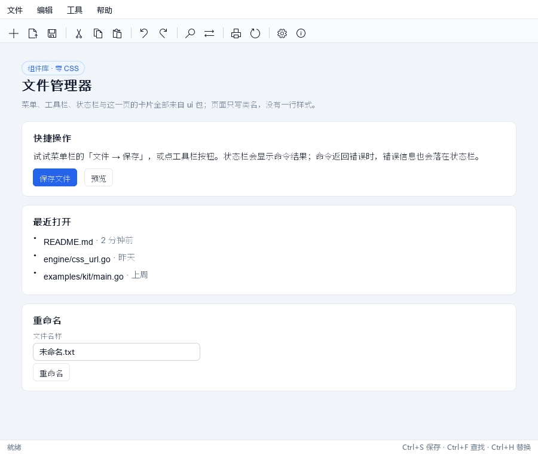
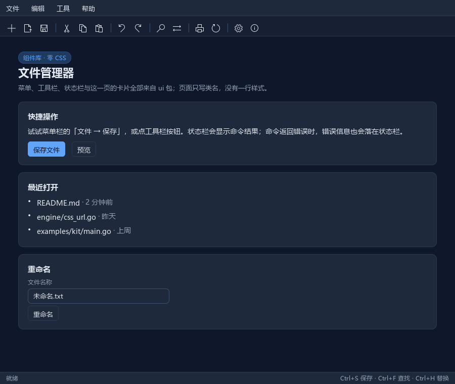
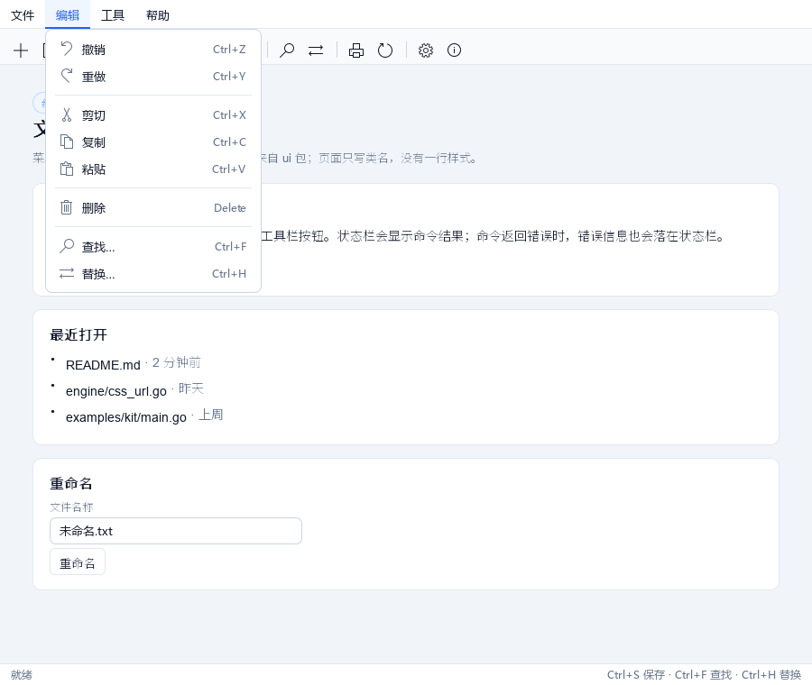
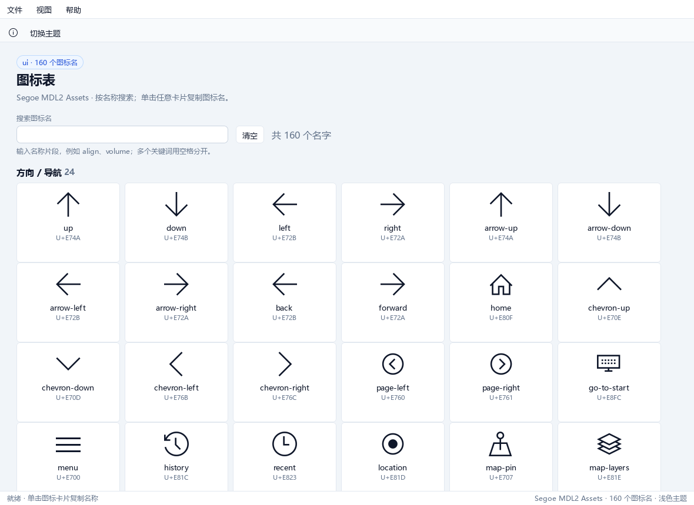
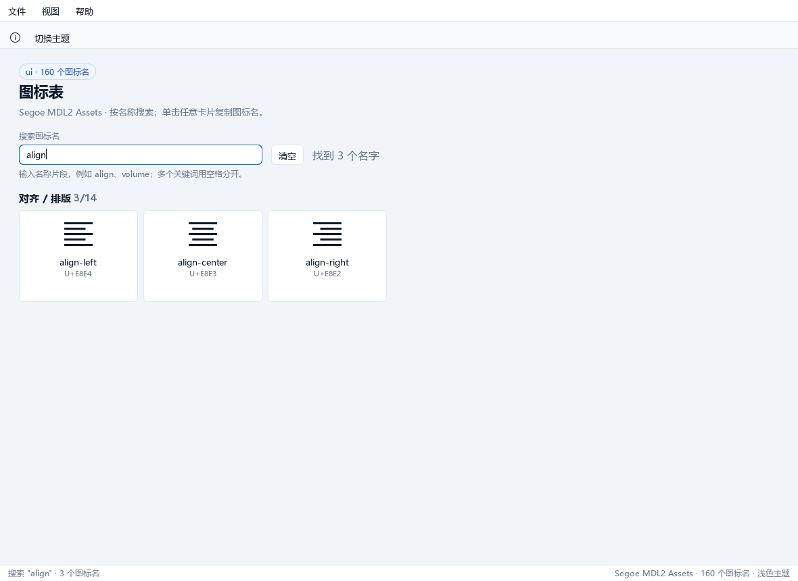

# Ghromex

用 HTML/CSS 写原生桌面 GUI 的迷你 WebView 框架。

用 Go 实现一个小型渲染引擎：解析 HTML/CSS → 级联计算样式 → 盒式布局 → 绘制指令交给渲染后端（当前为 SDL2，纯动态加载，**无需 CGO**）。渲染 1 CSS px = 1 物理像素，窗口尺寸即视口尺寸，天然适合桌面小部件与内部工具界面。

## 特性

- 纯 Go 渲染引擎：HTML 解析、CSS 级联、选择器（标签 / `.class` / `#id` / 简单组合，含特异度）、块级与行内（inline / inline-block）布局、文本按词/按字换行
- 行内排版：`line-height`（normal / 倍数 / 百分比 / px；行距一半在文字之上、一半在之下，行盒高度严格等于声明值，倍数与百分比相对元素自身字号解析）、`vertical-align`（baseline / top / middle / bottom / text-top / text-bottom / sub / super / 长度 / 百分比；行内盒相对基线摆位，`<sup>`/`<sub>` 走同一条 UA 规则）
- 伪类：`:hover` / `:focus` / `:active` / `:checked` / `:disabled` / `:enabled` / `:first-child` / `:last-child` / `:only-child` / `:root` / `:empty` / `:not()` / `:nth-child()`；动态伪类的状态存在文档上（悬停/按下/焦点），状态变化触发重排重绘 → 级联重算，样式随之更新；`:hover`/`:active` 沿父链继承（鼠标停在子元素上时祖先同样匹配）
- 定位与层叠：`position: relative / absolute / fixed`、`top/right/bottom/left`（含负值）、`z-index`；脱流盒第二遍布局，包含块 = 最近非 static 祖先 padding box / 视口；绘制分常规层 + 定位层（z 升序，同 z 按文档序），`z-index` 非 0 的定位元素与 `fixed` 元素建立层叠上下文，内部定位子树先局部排序再整体落层
- 原生文件对话框：Windows Shell 的 `IFileDialog`（Vista 起的现代对话框），支持打开文件、打开多个文件、选择文件夹、另存为，带文件类型过滤与初始目录；纯 Win32 COM 调用，无 CGO、非 Windows 返回 `ErrUnsupported`
- 原生消息框：user32 的 `MessageBoxW`（信息/警告/错误/询问四种图标，OK、确定-取消、是-否、是-否-取消四种按钮组合），不走 COM、不需要 STA
- 可编辑输入：点击聚焦（蓝框 + 按点击位置落光标）、键入文字（含中文输入法）、Backspace / Delete 删除、鼠标拖选 / Ctrl+A 全选、Ctrl+C 复制选区（后端写系统剪贴板）、Ctrl+V 粘贴（后端读系统剪贴板；单行 input 粘贴多行文本折成单行，textarea 保留换行）、方向键 / Home / End 移动光标、Shift+方向键 / Shift+Home/End 扩展选区（锚点不动、活动端随按键移动，越过锚点后选区反向）、输入与退格替换选区、Tab 循环切换（text / password / textarea；password 可聚焦可输入，值全程按 ● 掩码，光标与点击定位同掩码口径，明文不落画不进 SVG，但 Ctrl+C 复制真实值）；`<textarea>` 多行编辑（折行显示、Enter 换行、跨行拖选、超出盒高的行不绘制、纵向滚动跟随光标并支持滚轮）；其余 input type 按 UA 外观区分渲染：radio/checkbox 13x13 控件、submit/reset/button 按钮外观（value 居中）
- 表单与链接控件：`<select>`/`<option>` 下拉（点击展开选项浮层，点选项选中并派发 `change`，下方放不下且上方放得下时整组上移，浮层压过流内容与定位层、命中测试同层序）；`<button>` 内容按 HTML 规范垂直居中（Chrome/Edge 同款，定高按钮尤其明显）、`<a href>` 链接（UA 蓝色 + 下划线，`SetOnNavigate` 注册导航回调，导航在 click 冒泡之后执行）
- 勾选控件：`<input type=radio|checkbox>` 点击切换选中（`checked` 布尔属性按存在性判定，API `IsChecked` / `SetChecked`）；选中态绘制强调色方块 + 白色对勾、强调色圆环 + 实心圆（Chrome 口径），radio 盒恒为正圆；radio 仅 name 非空且相同的项互斥（实测无 name / `name=""` 各自独立）；点 label（包裹其控件或 `for` 指向）等效点该控件
- DOM 式 API：`QuerySelector` / `GetBoundingClientRect` / `SetText` / `OnClick` / `OnKeyDown` / `IsChecked` / `SetChecked` 等；内容变化自动触发重排重绘。`OnKeyDown` 注册**元素级按键处理器**（派发给聚焦元素，处理器返回 true 表示已消费、引擎的默认动作不再执行，等价网页的 preventDefault）——浏览器地址栏「回车打开」、记事本查找框「回车查找」都靠它接，不必改引擎的默认动作；伪类状态也可直接读写：`SetHoveredElement` / `HoveredElement` / `SetActiveElement` / `ActiveElement` / `OnDocumentMouseMove`（自建主循环的应用层用它驱动 `:hover`/`:active`，`browser` 门面已自动接好）
- 应用层底座：`SetOnChanged` 变更回调（内容或**视口尺寸**变化都会通知——窗口缩放不改文档内容，只靠内容变更收不到信号）；失焦只停画、**不丢编辑状态**（光标与选区保留，页内菜单动作可作用于失焦的编辑区）；`CaretPosition` 查光标行列；`clipboard.Text` / `clipboard.SetText`（`runtime/clipboard`）读写系统剪贴板；`browser.RequestClose` 关窗
- 事件冒泡：命中测试找到最深元素，沿父链依次派发 `click` / `change` / `wheel`，随后执行引擎默认动作（select 展开/选中、勾选切换、链接导航）
- 滚动与裁剪：`overflow(visible/hidden/clip/scroll/auto，单值两轴、两值 x y、overflow-x/overflow-y 分轴)` 滚动容器（滚轮驱动、子树平移 + padding 盒裁剪，被裁内容不可命中）、**圆角裁剪按 border-radius 的形状**（`overflow:hidden` 的圆角盒，溢出到角外的子元素按圆角裁掉，角上透出盒后底色）、文档级页面滚动（根元素以视口为滚动盒，长页面/宽页面均可滚）、`wheel` 事件（`OnWheel` 注册、`MouseEvent.DeltaX/DeltaY` 像素位移、冒泡派发）、Shift+滚轮 转横向滚动、textarea 滚轮滚动（与光标跟随同夹紧口径，全量吸收纵向滚轮、撞边界不带动页面）；裁剪经 `Graphics` 可选 `Clipper`（`PushClip`/`PopClip`，逐层求交）落地：`BufferGraphics` 像素断言、SDL2 `SDL_RenderSetClipRect`，SVG 导出同步生成 `clipPath`
- 可插拔图形后端：`engine.Graphics` 接口（DrawText / DrawColor / DrawImage / MeasureText），内置 `FakeGraphics`（计数）、`BufferGraphics`（软件光栅化到 RGBA 缓冲，可 `DumpPNG`）供无显示器测试；圆角抗锯齿走**角标精灵**（可选扩展 `SpriteDrawer`：整块圆角一次 blit，替掉逐像素的半透明小方块）——绘制调用数是 GPU 路径上的主要开销，portal 页一帧从 31840 次降到 2500 次、单帧绘制 149ms → 8.7ms（软件渲染器实测），滚动动画才不会被切成几帧；精灵的像素（引擎侧）与纹理（后端侧）都按「条数 + 像素」双上限、LRU 淘汰——键里含颜色，页面逐帧改色（动画）会不断产生新精灵，不设上限就是内存/显存泄漏；**填充率**同样要命：SDL 的绘制混合模式一旦开着，每块不透明填充都走逐像素混合（软件光栅器 2.1ns/像素，直接写像素只要 0.2ns），门户页一帧要填 1700 万像素——2560×1440 的窗体下单帧 37ms，**最大化后滚动只剩 27fps**（小窗体看不出来）。按填充的 alpha 临时切换混合模式（画完复原，贴图拷贝还要混合）后，门户页整帧（软件光栅器，含呈现）：800×600 1.35ms、1280×820 1.95ms、1920×1080 2.84ms、2560×1440 **4.07ms**（原 37ms，9 倍）、3840×2160 7.11ms；画面逐像素不变。清屏也不再重复铺白底（画布背景不透明时白底那层完全被盖住）。**诊断**：`GHROMEX_DEBUG=1` 会打印渲染路径与驱动名（默认 `renderer=software (driver=software; 默认内存渲染)`；`GHROMEX_GPU=1` 时 `renderer=accelerated(GPU, driver=direct3d; GHROMEX_GPU=1)`）——软件路径的瓶颈是填充率，GPU 路径通常在纹理上传/draw call/swap 间隔（GPU 路径实测：1280×820 到 4K 的整帧都是 16.6ms = vsync 周期，稳在 60fps；其中 GPU 真实工作只有 1.3~3ms，其余 13.5~14.5ms 是等 vsync）。**这些数字的口径与分段拆解见「性能实测」**——不同口径的数不能并排比
- 元素注册表：`CustomElements().Define(tag, proto)` + `CloneElement` 注册自定义标签，解析时克隆原型生成独立实例
- 无头运行：`-dump-svg` 导出布局结果；`NewBufferedViewport` / `OpenBufferedDocument`（视口 + 软件光栅化缓冲）可在 CI 中像素级断言渲染结果；真实窗口的最终观感用 `Window.Screenshot()` 回读窗口像素（应用自行编码 PNG，见 `examples/snip`）

## 环境要求

- Go 1.20+（go.mod 基线，作库供其他项目引用，1.20 以上工具链均可构建；无需 CGO）
- 渲染后端目前提供 Windows 实现（`backend/sdl2`，加载 `SDL2.dll` 2.28 与 `SDL2_ttf.dll`）
- 把 `SDL2.dll`、`SDL2_ttf.dll`（及 `zlib1.dll`）放到工程根目录 `libs/`，或保证系统可搜索到它们
- 平台边界：`engine` 包是纯 Go、可移植的；`backend/sdl2` 是渲染后端——Windows 提供 SDL2 实现，其它平台 `NewWindow` 返回 `ErrUnsupported`；`runtime/` 是平台能力的通用调用入口（`runtime/dialog` 原生对话框、`runtime/clipboard` 系统剪贴板、`runtime/screen` 桌面抓屏），平台实现在 `backend/dialog`、`backend/clipboard`、`runtime/screen` 内部；Windows 用纯 Win32 / SDL2 调用实现，其它平台返回 `ErrUnsupported` 或空操作；`browser` 与 `examples/` 都不带构建标签，任意平台 `go build ./...` / `go test ./...` 都能通过，非 Windows 启动窗口时会打印明确提示
- 依赖方向：`core`（契约：Graphics/Viewport/Paint/Color…，叶子包）← `engine` 与 `backend/*` 各自向上依赖它，再由 `browser`（应用层：窗口 + 文档 + 主循环）把两者缝起来。平台层不 import 引擎，`core/arch_test.go` 把这条规则钉死

## 快速开始

示例按目录存放在 `examples/` 下。每个目录都是一个**可独立运行**的小程序
（页面可能是内嵌 HTML、HTML 资产或由 Go 构造，从任意工作目录运行都不
依赖当前路径）：

| 目录 | 运行 | 内容 |
| --- | --- | --- |
| `examples/ua` | `go run ./examples/ua` | 原生 UA 表单 + 常用标签：零作者 CSS，可与 Chrome/Edge 直接对照 |
| `examples/stylebook` | `go run ./examples/stylebook` | 样式全集：作者样式表（`<link>` 外链 + `go:embed`）逐节摆出引擎支持的全部标签与 CSS，每节带「支持/部分/不支持」徽标与边界注记；同一 `index.html` 可直接丢进 Chrome 对照 |
| `examples/browser` | `go run ./examples/browser` | 迷你本地浏览器：顶部常驻地址栏与后退/前进/刷新/首页按钮、底部常驻状态栏（页标题 + 说明，换页后仍在），地址栏可打开本地路径（相对路径/`file://`），支持 `about:home`/`about:back`/`about:forward`，外部链接与缺失文件显示提示页；需在仓库内运行 |
| `examples/portal` | `go run ./examples/portal` | 购物门户：fixed 工具条/品牌头/导航、层叠上下文、分类栏、秒杀与商品网格、搜索提示和购物车计数交互 |
| `examples/notepad` | `go run ./examples/notepad` | 仿 Windows 记事本：页面由 Go 构造 DOM，无 `index.html`；`ui` 菜单（菜单项带图标）/纯图标工具栏/状态栏（文件/编辑/格式/视图/帮助，新建/打开/保存/另存为/撤销/重做）、原生「打开/另存为/选择文件夹」对话框、查找替换栏、铺满窗口的多行编辑区、状态栏（文件名/行列/字符数）；`-file` 启动时打开文件 |
| `examples/snip` | `go run ./examples/snip` | 截图工具：冻结主屏拖选，松开后同一窗口原地缩成置顶无边框的悬浮预览（图片区即选区大小），拖动图片移动窗口，Ctrl+S 保存 PNG，Esc/关闭退出；`-delay` 留时间整理窗口 |

每个示例都支持 `-exit-after`（指定时长后自动退出，调试/CI）；出图按用途分两类，别混用：

```powershell
# 分析（无头，不需要显示器）
go run ./examples/ua -exit-after 3s     # 指定时长后自动退出（调试/CI）
go run ./examples/ua -dump-svg out.svg  # 级联+布局导出 SVG（真实 <text>），核对几何/层级/配色
go run ./examples/kit -dump-png out.png # 软件光栅 PNG（文字是占位方块），断言布局/配色
# 截图（真实窗口 + 真实字体；dummy 驱动可无显示器跑）
go run ./examples/kit -shot out.png
```

`browser/doc.go` 的「出图口径」小节有完整分工说明（分析用 dump-svg / dump-png，快照存档用 `BufferGraphics.DumpPNG`，截图用 `Window.Screenshot`）。

`examples/snip` 另有截图专用参数：`-source` 用一张图片代替真实桌面，`-shot-overlay`/`-shot-preview` 把选区页、预览页各存成 PNG 后退出（回读走 `Window.Screenshot`）；配合 `SDL_VIDEO_DRIVER=dummy` 即可在无显示器环境检查观感。

```powershell
go run ./examples/snip -source examples/kit/screenshot.png -shot-overlay overlay.png -shot-preview preview.png
```

预览窗口的拖动走 `browser.Window.SetFrameHandler`：鼠标事件只记目标位置，帧末合并成一次 `MoveTo`，拖动期间主循环以 1ms 轮询（空闲时 10ms）——逐事件移动窗口 + 10ms 休眠会把窗口位置量化成 10~20ms 一跳，看起来一顿一顿。选区遮罩只压暗 30%，底层内容仍然看得清。

交互示例：`examples/browser` 用 `SetOnNavigate` 接管链接点击：读取目标 HTML 并在同一窗口重新 `OpenDocument`，外壳用 `ui.Install` 装配——后退/前进/刷新/首页是带图标与可用态的 `ui.Tool`，示例页面下拉和地址栏是嵌在工具栏里的 `ui.Slot` 控件，状态栏显示页面标题（引擎没有独立的窗口 chrome 层，换页时重装一套工作台；页面靠 `Spec.NoBodyReset` 保住自己的 body 排版），浏览历史支持后退/前进/刷新/首页（没有可后退的页面时按钮置灰），地址栏里按回车直接打开当前输入的地址，未知协议与读取失败会生成带返回链接的提示页；`examples/portal` 用固定顶栏 + 绝对定位侧栏组成购物门户，搜索框聚焦后显示热门提示，所有「加入购物车」按钮共享一个计数徽标。

`examples/notepad` 是最"应用"的一个：菜单、工具栏、快捷键和状态栏交给 `ui`（`ui.Install` 生成工作台，`ui.Spec` 声明命令），示例只保留记事本自己的部分——编辑区几何由程序按窗口尺寸算出（CSS 没有 `calc`，固定栏高度取 `ui.Theme`），查找替换栏与撤销/重做栈由应用层维护（引擎不内置撤销），文件读写与剪贴板走平台能力（`runtime/dialog` 的原生文件对话框 / `runtime/clipboard` 的系统剪贴板）。`ui.Workbench.SetStatusVisible` 支撑「视图 → 显示状态栏」，快捷键由 `Workbench.HandleKey` 接到窗口。

## 代码示例

```go
package main

import (
	"fmt"

	"github.com/go-comm/ghromex/backend/sdl2"
	"github.com/go-comm/ghromex/engine"
)

func main() {
	win, err := sdl2.NewWindow(800, 600, "Hello Ghromex")
	if err != nil {
		panic(err)
	}
	defer win.Close()

	doc, err := win.OpenDocument(`<body style="padding:16px">
		<button id="ok" style="background-color:#2563EB;color:#FFF">点我</button>
		<span id="n">0</span>
	</body>`)
	if err != nil {
		panic(err)
	}

	n, clicks := doc.QuerySelector("#n"), 0
	doc.QuerySelector("#ok").OnClick(func(ev *engine.MouseEvent) {
		clicks++
		n.SetText(fmt.Sprintf("已点击 %d 次", clicks)) // 修改文档即触发重排重绘
	})

	// 注意：SDL 要求窗口生命周期在同一 OS 线程，NewWindow/Run/Close 必须在同一 goroutine
	if err := win.Run(); err != nil {
		panic(err)
	}
}
```

无头测试（不依赖任何 DLL）：

```go
// 只做布局（不需要像素）：FakeGraphics 后端，绘制指令只计数
vp := engine.NewHeadlessViewport(400, 300)
doc, _ := engine.OpenDocument(vp, `<html><body><div class="box">hi</div></body></html>`)
```

要出图 / 逐像素断言像素时，用带缓冲的视口——视口与缓冲同尺寸，一次建好：

```go
// 只要视口：vp, buf := engine.NewBufferedViewport(400, 300)
buf, doc, err := engine.OpenBufferedDocument(400, 300,
	`<html><body><div class="box">hi</div></body></html>`)
if err != nil {
	panic(err)
}
_ = buf.DumpPNG("out.png") // OpenBufferedDocument 已画过一帧；或直接 buf.ColorAt(x, y) 断言像素
```

### 原生对话框

Windows 上可弹系统原生的文件对话框（打开文件 / 打开多个文件 / 选择文件夹 /
另存为），外观与资源管理器一致，支持文件类型过滤与多选：

```go
win, _ := browser.New(900, 620, "记事本")
paths, err := win.OpenFileDialog(browser.DialogOptions{
	Title:      "打开",
	DefaultDir: `C:\Users\me\Documents`,
	Filters: []browser.FileFilter{
		{Name: "文本文件 (*.txt)", Pattern: "*.txt"},
		{Name: "所有文件 (*.*)", Pattern: "*.*"},
	},
})
// 用户取消时 paths 为空、err 为 nil；非 Windows 平台 err 为 browser.ErrUnsupported。

// 一次选多个文件用 OpenMultipleFilesDialog（返回多个路径）。
many, err := win.OpenMultipleFilesDialog(browser.DialogOptions{Title: "批量打开"})
```

还有原生消息框（提示 / 警告 / 询问），走 user32 的 `MessageBoxW`：

```go
res, err := win.MessageDialog(browser.MessageOptions{
	Title:   "确认",
	Message: "文件已存在，要覆盖吗？",
	Icon:    browser.IconQuestion,
	Buttons: browser.ButtonsYesNo,
})
if err == nil && res == browser.ResultYes {
	// 用户点了「是」
}
```

对话框是模态的：调用期间阻塞当前线程（父窗口的 SDL 事件循环随之暂停），
在按钮/菜单的回调里直接调用即可。文件对话框走 Shell 的 `IFileDialog`（纯
Win32 COM 调用，无 CGO），消息框走 user32 的 `MessageBoxW`（不需要 COM、
不需要 STA），细节见 `runtime/dialog/dialog.go`。

## 组件库 ui

`ui` 是建在 `browser` 之上的一层「应用工作台」：菜单栏（下拉浮层、快捷键、
禁用态）、工具栏、状态栏、主题，外加一套只写类名的页面组件。应用侧只需
一张命令表（`save`/`about` 是返回 `error` 的函数，`editor.Dirty` 是
`func() bool`）：

```go
spec := ui.Spec{
	Title: "我的应用", Width: 900, Height: 700,
	StatusSegments: []ui.StatusSegment{
		{Key: "file", Text: "就绪", Width: 220},
		{Key: "pos", Text: "行 1，列 1", Width: 140},
	},
	StatusRight: "Ctrl+S 保存",
	Menus: []ui.Menu{{Title: "文件", Items: []ui.Action{
		ui.Item("保存", "Ctrl+S", save).WithIcon("save").When(editor.Dirty),
		ui.Sep(),
		ui.Item("退出", "Alt+Q", ui.Quit),
	}}},
	Tools: []ui.Action{
		ui.Tool("保存", save).WithIcon("save").When(editor.Dirty),
		ui.Sep(),
		ui.Tool("关于", about).WithIcon("info"),
	},
}

app, err := ui.New(spec)
if err != nil {
	return err
}
defer app.Close()
if _, err := app.LoadHTML(page); err != nil {
	return err
}
return app.Run()
```

状态栏左侧可以分段：`StatusSegment.Width` 固定列宽（0 为按内容自适应），
`Align` 控制段内对齐，`Hidden` 可临时隐藏；段与段之间自动生成 1px 分隔线。
高频更新只改文字，不重建 DOM：

```go
sh.SetStatusSegment("file", "README.md *")
sh.SetStatusSegment("pos", "行 12，列 4")
sh.SetStatusSegment("chars", "1,024 个字符")
```

右侧消息独立更新（`SetStatusRight`），非空时按 `Theme.StatusRightWidth`
预留宽度；旧写法 `Spec.Status` / `SetStatus` 仍可用，等价于一个
`Key: "status"` 的段。

内置浅色与深色两套主题，`Spec.Theme` 留空时用浅色；换深色只需：

```go
dark := ui.Dark()
spec.Theme = &dark
```

页面内容只写类名，样式全部来自注入的主题样式表：

```html
<div class="system-ui-page">
	<span class="system-ui-badge">新</span>
	<div class="system-ui-title">文件管理器</div>
	<div class="system-ui-subtitle">一行说明</div>
	<div class="system-ui-card">
		<div class="system-ui-h2">快捷操作</div>
		<div class="system-ui-text">正文</div>
		<span class="system-ui-label">名称</span>
		<input class="system-ui-input" type="text">
		<div class="system-ui-actions">
			<div class="system-ui-btn is-primary">保存</div>
			<div class="system-ui-btn">预览</div>
		</div>
	</div>
</div>
```

控件也可以由 Go 侧构造，省去类名和取值/禁用态的样板；返回的 `*XxxView`
都实现了 `Element()`，可以放进任意页面容器：

```go
name := ui.NewTextInput(doc, "未命名.txt")
field := ui.NewField(doc, "文件名称", name)
field.SetHint("最多 255 个字符")
page.AppendChild(field.Element())

auto := ui.NewCheckbox(doc, "保存时自动备份", true)
auto.OnChange(func(on bool) { /* ... */ })
page.AppendChild(auto.Element())

enc := ui.NewSelect(doc, []ui.SelectOption{
	{Value: "utf-8", Label: "UTF-8"},
	{Value: "gbk", Label: "GBK"},
})
enc.OnChange(func(value string) { /* ... */ })
page.AppendChild(enc.Element())

preview := ui.NewTextView(doc, "只读多行文本；换行会保留。")
page.AppendChild(preview.Element())
```

`ui.NewButton` 是内容区按钮（底层 `<button type="button">`），与工具栏的
`ui.Tool`（构造 `Action`）区分。`TextInput`/`TextArea` 目前没有实时的
`input`/`change` 事件，实时联动请用 `OnKeyDown`，或在命令执行时读取
`Value`。`TextView` 是只读多行视图，`TextAreaView` 才是可编辑输入。

可用组件类：`system-ui-page`/`system-ui-title`/`system-ui-subtitle`/`system-ui-badge`/`system-ui-alert`/`system-ui-card`/
`system-ui-h2`/`system-ui-text`/`system-ui-label`/`system-ui-input`/`system-ui-select`/`system-ui-textarea`/
`system-ui-textview`/`system-ui-check`/`system-ui-field`/`system-ui-field-hint`/`system-ui-field-error`/
`system-ui-btn`/`system-ui-actions`/`system-ui-list`/`system-ui-muted`。

所有组件类都带 `system-ui-` 前缀，并且只在 `Install` 加到 `<html>` 上的
`system-ui` 根作用域下生效；根作用域把组件规则的特异度抬高一档，第三方
`.panel div` 之类的后代选择器压不过。前缀本身不保证唯一，避免重名仍以
根作用域为主。

主题内置六组语义色，按钮、徽标、提示条用 `is-*` 后缀，文字色用 `system-ui-text-*`：

| 语义 | 后缀 | 浅色实底 / On | 深色实底 / On | 用途 |
| --- | --- | --- | --- | --- |
| 强调 Primary | `is-primary` | `#2563EB` / `#FFFFFF` | `#60A5FA` / `#0B1220` | 主按钮、选中、焦点 |
| 默认 Default | `is-default` | `#FFFFFF` / `#0F172A` | `#1E293B` / `#E2E8F0` | 次按钮、取消 |
| 成功 Success | `is-success` | `#15803D` / `#FFFFFF` | `#4ADE80` / `#052E16` | 完成、通过 |
| 警告 Warning | `is-warning` | `#F59E0B` / `#451A03` | `#FBBF24` / `#451A03` | 待处理、风险 |
| 危险 Danger | `is-danger` | `#DC2626` / `#FFFFFF` | `#F87171` / `#2A0505` | 删除、错误 |
| 信息 Info | `is-info` | `#0E7490` / `#FFFFFF` | `#22D3EE` / `#083344` | 说明、辅助 |

```html
<div class="system-ui-actions">
	<div class="system-ui-btn is-success">通过</div>
	<div class="system-ui-btn is-danger">删除</div>
</div>
<span class="system-ui-badge is-warning">待处理</span>
<div class="system-ui-alert is-info">共 12 项，已全部同步。</div>
<span class="system-ui-text-danger">保存失败</span>
```

按钮用实底/`On*`；徽标与提示条用 `*Soft` 淡底、`*Border` 描边和 `*Text`
文字。`Default` 不单独存令牌，复用 `Surface`/`Border`/`Text`/`SurfaceAlt`/
`Press` 这组中性色。对比度由主题负责（Warning 的实底用深色字，其余实底在
浅色主题用白字、深色主题用同色系深字）。







几个设计约定：

- **命令与呈现分离**：`Action` 同时给菜单项和工具栏按钮用，快捷键只写一次；
  `Run` 返回 `error`，错误直接写到状态栏，`ui.Quit` 请求关窗。
- **可用性是拉取的**：`When(f)` 在菜单打开时、`Refresh()` 时求值，不做每帧
  轮询；禁用项点击无效、快捷键仍会被吞掉（不会漏到页面里）。
- **快捷键先于页面**：走 `browser.Window.SetKeyHandler`，输入框聚焦时
  `Ctrl+S` 也先到应用。修饰键按家族匹配（左右 Ctrl 都算），字母不分大小写。
- **换文档自动重装**：工作台是文档的一部分（`position:fixed` + body 首尾占位块），
  `App` 通过 `SetOnDocument` 在每次 `OpenDocument` 后重装；只想要文档层
  （无头导出、嵌进已有窗口）时直接用 `ui.Install(doc, spec)`。
- **主题是令牌**：内置 `ui.Light()` 与 `ui.Dark()`，各生成一整张样式表；改
  `ui.Theme` 的字段即可换色/换圆角（`spec.Theme = &theme`）。深色主题的强调色
  更亮，主按钮文字由 `OnAccent` 保证对比度。语义色每组都有实底、悬停、`On*`、
  淡底、描边和淡底文字；`Default` 复用中性令牌，避免同一颜色存两份。主题测试
  用 WCAG AA 的 4.5:1 校验实底与淡底文字。零值字段统一按浅色补齐，所以微调
  深色要先取 `ui.Dark()` 再改字段，不能只写一两个颜色指望自动变深。只使用引擎
  支持的 CSS 子集；主题保持扁平（不用阴影），没有过渡，横向排列靠 `inline-block`，
  分隔线是 1px 的实体元素。
- **图标是字体字形**：`WithIcon("save")` 从内置表取 Segoe MDL2 Assets 的码位，
  覆盖文件/编辑、方向/导航、对齐/排版、播放/媒体、视图/窗口和通用命令（完整表
  见 `ui/icon.go` 的 `iconGlyphs`），也可以直接传字符。工具栏有图标时只画图标
  （30×30 方形按钮），没图标时退回文字；菜单里只要有一项带图标，整张菜单就
  预留图标列。图标字体是 Windows 10/11 自带的 `segmdl2.ttf`（颜色跟随 `color`，
  悬停/禁用自动变色）；其他平台在 `Theme.IconFont` 里换一个同编码的字体，或者
  不调 `WithIcon` 只用文字。

常用图标名：

| 分类 | 图标名 |
| --- | --- |
| 方向/导航 | `up` `down` `left` `right` `chevron-up` `chevron-down` `chevron-left` `chevron-right` `page-left` `page-right` `back` `forward` `home` `go-to-start` |
| 对齐/排版 | `align-left` `align-center` `align-right` `bulleted-list` `list` `check-list` `bold` `italic` `underline` `font-size` `font-color` `highlight` |
| 播放/媒体 | `play` `pause` `stop` `record` `previous` `next` `rewind` `fast-forward` `shuffle` `repeat` `repeat-one` `volume` `mute` `fullscreen` `back-to-window` |
| 文件/编辑 | `new` `open` `save` `save-as` `copy` `cut` `paste` `undo` `redo` `search` `replace` `print` `delete` `refresh` |
| 视图/窗口 | `zoom-in` `zoom-out` `fit-page` `view` `view-all` `preview` `dock-left` `dock-right` `dock-bottom` `close-pane` `open-pane` `minimize` `maximize` `restore` `window-close` |
| 通用 | `check` `close` `add` `remove` `more` `filter` `settings` `info` `help` `warning` `error` `completed` `favorite` `share` `link` `attach` `send` `folder` `calendar` `sort` `download` `upload` |

别名：`arrow-up`/`arrow-down`/`arrow-left`/`arrow-right`、`open-file`、`trash`、
`reload`、`printer`、`plus`、`minus`。

想看全部图标和实际字形，运行 `go run ./examples/iconsheet`；启动后可用工具栏
「切换主题」或「视图」菜单在浅色/深色之间切换，`-dark` 可直接以深色启动。
图标来自 `ui.Icons()`。顶部搜索框按名称实时过滤（多个关键词用空格分开），
也可以用 `-search align` 启动时预填；单击卡片会把名称复制到剪贴板。




限制：`ui` 不接管原生窗口菜单；菜单只支持鼠标操作（`Esc` 收起，没有方向键/
回车导航）；页面里 `z-index` 高于工作台（1100）的元素会盖住菜单栏；窗口很窄时
靠右的菜单浮层可能超出右边缘（浮层左对齐菜单标签，不做翻转）；内置主题只有
浅色/深色两套，更多配色改 `Theme` 字段。

跑一下示例（`-shot` 真实窗口截图：真实字体看最终观感，`-shot-menu` 连菜单一起拍）：

```
go run ./examples/kit
go run ./examples/kit -dark
go run ./examples/kit -shot kit.png -shot-menu 文件
go run ./examples/iconsheet
go run ./examples/iconsheet -dark
```

## 项目结构

```
core/             引擎与后端之间的契约（Graphics/Viewport/Paint/Color/Sprite…），
                  叶子包：engine 与 backend 都只依赖它，依赖方向保持单向
engine/            渲染引擎（纯 Go，不依赖任何图形后端）
  html_parser.go     HTML 解析 → DOM 树
  css_parser.go      CSS / 内联样式解析（含 @import 引用提取）
  css_url.go         外部样式表引用解析：相对引用 → 绝对地址（纯字符串）
  style_cascade.go   选择器匹配 + 特异度级联 + 继承
  style_ua.go        UA 样式表（默认值对齐 Chrome，含表单控件 border-box）
  measure.go         盒模型布局、行盒、换行、定位布局（relative/absolute/fixed）
  scroll.go          overflow 滚动容器 + 文档级滚动（偏移夹紧/子树平移/wheel 分发）
  render.go          绘制指令下发（背景/边框/文本片段/文本装饰/定位层/层叠上下文/裁剪栈）
  text_input.go      可编辑输入焦点/光标/编辑/Tab 循环
  select.go          select 展开态、选项浮层布局、取值与点击默认动作
  textarea.go        textarea 折行、光标↔坐标映射、纵向滚动
  anchor.go          `<a href>` 导航默认动作
  form.go            表单控件取值（GetValue/SetValue）与字体度量辅助
  form_render.go     input/textarea/select 专用绘制（含选项浮层）
  event_dispatch.go  命中测试（含裁剪感知）+ click/change/wheel 冒泡派发
  graphics.go        Graphics 接口 / FakeGraphics / BufferGraphics
  svg_dump.go        布局结果导出 SVG
  element_registry.go 标签原型注册表（自定义元素）
backend/sdl2/      SDL2 后端：窗口、事件解码、SDL_ttf 文本纹理缓存（LRU + 像素双上限，
                   页面文本段数超限时不再逐帧重渲染）、
                   圆角精灵纹理缓存（同样 LRU + 像素双上限；精灵像素不变，
                   纹理只上传一次）、
                   剪贴板读写（Ctrl+C 写 / Ctrl+V 读，引擎只管文本）、
                   原生窗口句柄（NativeHandle，供原生对话框当父窗口）。
                   平台层：只依赖 core，不认识引擎（主循环在 browser）
browser/           应用层：窗口 + 文档 + 主循环（平台事件 → 引擎动作 → 重排 → 重绘）
runtime/dialog/     原生对话框的通用调用入口（平台无关的类型 + 五个对话框：
                   打开文件 / 打开多个文件 / 选择文件夹 / 另存为 / 消息框）
runtime/clipboard/   系统剪贴板的通用调用入口（Text / SetText）
backend/dialog/     原生对话框的平台实现（Windows）：文件对话框走 Shell
                   IFileDialog（纯 Win32 COM，无 CGO），消息框走 user32
                   MessageBoxW（不需要 COM）。父窗口句柄由调用方传入
backend/clipboard/   剪贴板的平台实现（复用 SDL2 的剪贴板接口——引擎内部的
                   Ctrl+C / Ctrl+V 走的是同一条路径）
ui/                应用工作台组件库（在 browser 之上）：菜单栏/工具栏/状态栏、
                   下拉浮层、快捷键分发、主题令牌与页面组件样式；
                   `ui.App` 把「建窗 + 装工作台 + 换页重装」封装成十来行
examples/          可独立运行的示例（页面源码可能是内嵌 HTML、HTML 资产或由 Go 构造）：
  ua/                原生 UA 表单 + 常用标签（零作者 CSS，与 Chrome 对照）
  stylebook/         样式全集（作者样式表：index.html + stylebook.css 外链加载，
                     全标签/CSS 演示 + 支持级别徽标，与 Chrome 对照）
  kit/               组件库演示（菜单/工具栏/状态栏 + 卡片式页面，零作者 CSS）
  iconsheet/         内置图标表（全部名称/字形/码位，单击复制名称）
  browser/           迷你本地浏览器（常驻工具条 + 状态栏、历史/刷新、链接导航、错误提示页、
                     外部样式表加载：examples/browser/assets.go）
  portal/            购物门户（fixed 顶栏、层叠上下文、商品网格、秒杀、购物车交互）
  notepad/           仿 Windows 记事本（page.go 构造 DOM、菜单栏+浮层菜单/工具栏/查找替换栏/
                     编辑区/状态栏、文件读写、撤销重做栈、剪贴板）
libs/              SDL2 运行库（SDL2.dll / SDL2_ttf.dll / zlib1.dll，见 libs/README.md）
```

**包内文档**：每个包的入口说明写在各自的 `doc.go`（`go doc ./engine` 可读，
也进 pkg.go.dev）：engine 讲分层地图与「改代码前必读的不变量」、backend/sdl2
讲平台边界与线程约束、browser 讲三方分工与用法骨架、ui 讲命令模型（Action/
Spec）与工作台的三条约定（换文档重装、快捷键先行、只用手册内的 CSS 子集）；
`runtime/` 的分层约定（后端 vs 平台能力）见 `runtime/README.md`；`libs/`
里第三方 DLL 的版本、出处、许可与查找顺序见 `libs/README.md`。

## 已支持的 CSS 子集

`display(none/inline/inline-block/block，以及完整表格家族：table/inline-table/
table-caption/table-column(-group)/table-header-group/table-row-group/
table-footer-group/table-row/table-cell)`、`width/height`、
`box-sizing(content-box/border-box，表单控件 UA 默认 border-box 对齐 Chrome)`、
`margin*`（相邻块级兄弟折叠：取较大者；父-子穿越/空块折叠未实现）、`padding*`、
`border`/`border-top/right/bottom/left` 简写、`border-width/color/style`（1~4 值展开）
与 12 个单边长写（四边可独立宽度/颜色/样式）、`border-radius`(四角统一，仅水平半径)、
`border-collapse(collapse/separate)`、`border-spacing(1~2 值，px/pt/dp/%)`、
`caption-side(top/bottom)`、`empty-cells(show/hide)`、
`list-style-type(disc/circle/square/decimal/decimal-leading-zero/lower|upper-alpha/
lower|upper-roman/none)`、`list-style-position(outside/inside)`、`list-style` 简写
（`list-style-image` 接受但忽略，标记仍按 type 画）、
`box-shadow`（外阴影与内阴影 `inset`；逗号分隔多条、px/pt/dp 偏移/模糊/扩散、
颜色，第一条在最上层；内阴影按 padding 盒裁切并支持 `border-radius`）、
`background-color`/`background`、`color`、`font-size`、`font-weight(bold)`、`font-family`、
`text-align(left/center/right)`、`text-decoration(underline/line-through/none，随父链继承)`、
`white-space(normal/nowrap/pre/pre-wrap/pre-line)`（CSS Text §4.1 的三条正交行为：
`pre` 保留空白与制表符、按源换行强制断行、不软换行（长行溢出）；`pre-wrap` 同上但
在空格处软换行（不拆长词）；`pre-line` 折叠空白（含行首空白）但保留源换行；
`nowrap` 折叠空白且不换行；`break-spaces` 按 `pre-wrap` 近似；UA 的 `pre` 用 `pre`，
行内 `code`/`kbd`/`samp`/`tt` 仍是 `normal`）、
`line-height(normal/倍数/百分比/px)`（行距一半加在文字之上、一半加在之下，行盒高度
严格等于声明值；倍数与百分比相对**元素自身**字号解析，随父链继承的是**原始形态**
——父级 `1.5` + 子级 `font-size:32px` → 子级行高 48px）、
`vertical-align(baseline/top/middle/bottom/text-top/text-bottom/sub/super/长度/百分比)`
（不继承；只作用于行内级盒——引擎里行内元素都是「原子盒」，`middle` 的半个 x 高度
按字号 0.52 估，SDL_ttf 无 x 高度接口；`super`/`sub` 的位移量取 Chrome 实测的
「父字号/3+1」「父字号/5+1」，`<sup>`/`<sub>` 即走这条 UA 规则）、
**伪类**（`:hover`/`:focus`/`:active`/`:checked`/`:disabled`/`:enabled`/
`:first-child`/`:last-child`/`:only-child`/`:root`/`:empty`；伪类按 class 档计
特异度。`:hover`/`:active` 沿父链继承——鼠标停在子元素上时祖先同样匹配；
`:focus` 只落在焦点元素上。动态伪类的状态存在文档上，状态变化走
「变更通知 → 重排重绘 → 级联重算」，与浏览器的链路一致；
函数型伪类 `:not(选择器列表)`（参数列表任一命中即排除，特异度取参数
最高者）与 `:nth-child(An+B)`（odd/even/整数/2n+1 全语法，只数元素兄弟）
已实现，参数在解析期预解析；`:is()` 等其余函数型伪类与非法参数按
CSS 语义整条选择器无效，永不匹配）、
**伪元素** `::before`/`::after`（单冒号旧写法 `:before`/`:after` 等价；
`content` 支持带引号字符串、`attr(属性名)` 与多分量拼接，`none`/`normal`
不生成盒子；生成盒默认 `display:inline`，可写 `width/height/padding/
border/background/position` 等常规属性，参与布局、绘制、命中与 SVG 导出，
但不出现在 `Children()`/`InnerText`/查询结果里——不是 DOM 节点；
`counter()`/`url()`/`open-quote` 等取值未实现）、
`position(relative/absolute/fixed)`、`top/right/bottom/left`(px 与 %，支持负值；
absolute/fixed 相对包含块锚定，right/bottom 回推)、`z-index`（非 0 的定位元素与 fixed 元素建立层叠上下文；z:auto 与 z:0 暂不区分）、
`overflow(visible/hidden/clip/scroll/auto：单值作用两轴、两值为 overflow-x overflow-y、
overflow-x/overflow-y 分轴；hidden 只裁不滚，scroll 恒可滚，auto 溢出时可滚，
文档级滚动不受 html overflow 关键字约束)；
`float(left/right/none)`/`clear(left/right/both/none)`（浮动盒脱流、auto 宽按
shrink-to-fit 收缩，行盒按浮动边缘收缩、块盒按 `clear` 下推到浮动下缘之下；
浮动不撑开父级 auto 高度——与 Chrome 同口径，作用域简化见「已知限制」）、
`opacity(0~1 数字/百分比，越界钳到 [0,1])`（不做图层合成，按「子树每次绘制
动作的颜色 alpha 乘 opacity」近似，见「已知限制」）、
`visibility(visible/hidden/collapse)`（hidden/collapse 自身不绘制、不可命中，
但照常占位；子级显式 `visible` 可恢复显示与命中）、
`cursor`（系统指针子集：`default/auto/pointer/text/move/wait/crosshair/
not-allowed/grab/grabbing/ew|ns|nwse|nesw-resize`；`url()` 自定义光标退回
`auto`，逗号后的回退关键字优先。SDL2 后端落到系统指针，无头/软件光栅化忽略）、
`font-style(normal/italic/oblique)`（italic/oblique 都走 SDL_ttf 的合成斜体，
不改变字形前进宽度——布局度量与正体一致，只有绘制与 SVG 导出体现倾斜）、
inline-block 的百分比宽度按包含块内容宽解析（而非行内剩余宽）；
UA 默认样式表覆盖浏览器 Windows 侧的常用规则：body 外边距 8px、
h1-h3 字号/外边距、p 段距、a 蓝色下划线、strong/b 加粗、
em/i/cite/var/dfn 给 `font-style: italic`、`a` 给 `cursor: pointer`、表单控件给
`cursor: text`/`font-style: normal`；em/i/code/small/sub/sup 等行内语义标签为 inline（sub/sup 另按 Chrome 实测做
基线位移：上标 `父字号/3+1`、下标 `父字号/5+1`，字号取 smaller 的 13px）、
dt **不加粗**（Chrome UA 实测计算权重 400；HTML4 的 UA 才加粗 dt）、
dd 缩进 40px、ul/ol 缩进 40px、blockquote/pre/figure 外边距、
`pre`/`code`/`kbd`/`samp`/`tt` 只给 `font-family: monospace`（**不写死字号**：继承父级，
父级从未声明字号时才落到通用族默认 13px；`tt` 另补 `display: inline`）、
hr 边框、form/input/select/textarea/button 的尺寸与外观（多行控件的基线按
CSS 2.1 §10.8.1 取底外边距边——Chrome 的 textarea 计算 overflow 非 visible）；
**交互反馈（悬停/按下）**：按钮型控件（`<button>` 与 `<input type=submit/reset/button>`
同款）底色与边框一起加深（悬停 `#EFEFEF`→`#E3E3E3`、按下→`#D4D4D4`，边框
`#767676`→`#6A6A6A`/`#4F4F4F`），文本类控件（text/password/select/textarea）
只加深边框，勾选控件（radio/checkbox）不参与——**这是与 Chrome UA 样式表的
有意分歧**：Chrome 没有 hover 规则（浏览器里按钮悬停不变色），但作为桌面 UI
框架，按钮悬停毫无反馈会显得「死了」。作者 CSS 仍可覆盖（作者来源优先于 UA
来源，与 CSS 级联一致）；
表格完整模型（display 家族 + colspan/rowspan + border-spacing + 题注），
列表标记为引擎自绘（支持 list-style-type / list-style-position），几何仍是近似模型，见「已知限制」；
字体默认语义对齐 Chrome（Windows）并做 UI 取向调整：初始字号 16px；
standard（未指定 family）默认 sans-serif → Arial（区别于 Chrome 的 Times，更贴桌面 UI）；
serif → Times New Roman、sans-serif → Arial、system-ui → Segoe UI、fantasy → Impact、
monospace/cursive → 新宋体（Chrome 在中文 Windows 上的默认等宽字体就是新宋体，
实测 16px 每字符 8px、行高 18，而不是 Courier New / Comic Sans MS；引擎用 simsun.ttc）；
表单控件 UA 默认字体 `Arial, system-ui, sans-serif`（首项 Arial = 引擎默认字体、
桌面 UI 取向；追加 system-ui 只影响 CJK 回退档位——Chrome 控件的汉字落雅黑、
13px 行高 17，若按 Arial 落 Noto Sans 会把按钮撑高 2px）；
`font-family` 首项为 monospace/ui-monospace 且作者从未显式声明过 font-size 时，
计算字号取通用族默认等宽字号 13px（Chrome 实测：body 不写字号 +
`font-family: monospace` → 13px；祖先显式给过 16px 则保持 16px）；
汉字/假名/谚文按字符级脚本分段 fallback，且按 generic family 分流到 Chrome
在中文 Windows 上实际使用的系统字体：sans-serif/Arial/Segoe UI → Noto Sans SC、
serif/Times → Noto Serif SC、monospace/cursive → 新宋体、system-ui → 微软雅黑；
显式指定中文字体族（雅黑/黑体/宋体/等线…）时该字体自带 CJK 字形、不触发
逐字回退；Noto CJK 在系统上通常是 VF 单文件且 fvar 默认字重是 Thin(100)，
SDL2_ttf 读不了 VF 命名实例（Chrome 经 DirectWrite 取 400/700 实例），引擎
因此优先用 `tools/gen-cjk-instances.ps1` 生成的静态 Regular/Bold 面
（落 `libs/fonts/`，gitignore）——未生成时退回 VF 本体（正文偏细）；
行盒（line-height: normal）直接用 SDL_ttf 的 `TTF_FontAscent`/
`TTF_FontDescent`：行盒高 = 各内联盒「基线以上高度」的最大值 +
「基线以下高度」的最大值，无内容时不加 strut。该口径是 FreeType 的像素
取整，不再逐像素对齐 Chrome/DirectWrite（同一字体行高可能差 1~4px），
换取不解析字体表的实现简化；声明了 `line-height` 时改按声明值分 Leading
（一半在文字之上、一半在之下，half-leading 取 floor(leading/2+0.5)，
与 Chrome 的基线落点一致），行盒高度严格等于声明值；
粗体按字体族选**真粗体字文件**（雅黑 → msyhbd.ttc、Arial → arialbd.ttf、
Segoe UI → segoeuib.ttf、Noto Sans/Serif SC → 生成的 NotoSansSC-Bold.ttf），
不依赖 FreeType 对常规字形的合成加粗——合成加粗
明显更重，24px 中文标题上还会出现笔画粘连/重影（浏览器按字体族选粗体字重，
同页对照下 h2 墨量比由 1.26 收敛到 1.01）；无真粗体文件的字体（黑体等）
仍走合成加粗，与浏览器一致；
每个 (字体文件, hinting 档位) 只开一个 FT_Face，字号/粗体动态切换
（档位进 key 是为支持运行中切 `GHROMEX_HINT`；切换会新开一个 face）；
文本渲染默认走灰度 AA（无彩边、对落点背景色不敏感），hinting 档位由
`GHROMEX_HINT` 控制（`normal|light|mono|none`，默认 normal）：与 Chrome 灰度
基线的同页对比矩阵（fontcmp 口径指标，13px 中文）显示 normal 最同构——
竖画硬跳变 7（Chrome 0）、横画 237（Chrome 227）、墨核 412（Chrome 347），
而 light 档横画偏软（75，即"糊"感来源）；要更柔可 `GHROMEX_HINT=light`。
`GHROMEX_CONTRAST=k`（>1 生效，如 1.3/1.5，上限 3，默认关）在 blended
覆盖通道施加 Skia 同类的对比度 tone 曲线（以 0.5 为枢轴推两端：边缘更实、
毛边更净），代价是墨色变重、竖边台阶感随 k 增大，常与 light/none 档联调
提利。`GHROMEX_LCD=1` 切换到
LCD 子像素（TTF_RenderUTF8_LCD + LIGHT_SUBPIXEL hinting，竖笔画边缘横向
锐度与浏览器 ClearType 同级；合成按文字落点背景色进行——渲染管线沿父链
携带最近实底，深色背景上白字不会带白底块。代价是彩底上竖笔边缘有轻微
彩边（与浏览器子像素渲染同性质）；LCD 打开时 hinting 强制 subpixel，
`GHROMEX_HINT` 仅影响灰度路径）。灰度 AA 的取舍已定量确认为固有性质、非管线失真：
探针 `backend/sdl2/gray_text_test.go` 以同 face 同 hinting 直出 blended
surface 合成白底，与 `DrawText→RenderCopy→Screenshot` 落屏结果逐像素
比对，双渲染器偏差均值 <1.3、最大 3（超差 >4 为 0%），即绘制链路无
失真；观感软硬由档位选择决定（锯齿与模糊是同一参数的两端），
另受灰度 AA 无横向子像素分解的物理极限约束——用 `GHROMEX_HINT` /
`GHROMEX_CONTRAST` 在锐度谱上取点，需要横向锐度请开 `GHROMEX_LCD=1`
走 LCD 子像素路径；
选择器支持标签、`.class`、`#id`、类型+class/id 组合链（如 `div.wide`）与特异度排序。

**外部样式表**：`<link rel="stylesheet" href>` 与 CSS 的 `@import`（可嵌套）都支持。
相对引用由引擎解析成绝对地址——`<link>` 相对文档地址，`@import` 相对**上一层样式表**
的地址（主题文件放在子目录里，`../` 也不会被解析到页面目录去）。引擎不碰 I/O，
加载器由宿主提供：

```go
doc, err := engine.OpenDocumentWith(vp, src, engine.DocumentOptions{
	BaseURL: "file:///C:/pages/index.html", // 本地文件先转成 file:// 地址
	LoadStylesheet: func(href string) (string, error) {
		// href 已是可直接使用的绝对地址（相对引用早在引擎里拼好了）
		return os.ReadFile(pathFromFileURL(href))
	},
})
```

`OpenDocument` 等价于不传加载器（`<link>`/`@import` 被忽略，与旧行为一致）。加载是
**同步**的、发生在解析阶段，所以选项必须在打开文档时给——事后再装加载器不会补加载
页面里已有的引用。加载失败只跳过那一份样式表（页面照常打开、其余样式生效），错误由
加载器自己上报；`@import` 的循环引用在链上截断（深度上限 32）。`media` 属性不参与
筛选（引擎不分媒体，与 `@media` 被跳过同口径）。`examples/browser` 把它接到了本地
文件系统（`assets.go`，只认 `file://`），演示页是 `external.html`。

## 已知限制

- **绑定层的结构体大小必须与运行库一致**：SDL 的结构体按值跨越 DLL 边界（Go 侧申请内存、SDL 按自己的大小写），估小了就是**越界写坏调用者的栈**。实例：`SDL_RendererInfo` 曾按「name + flags + num_texture_formats + 指针」估成 32/40 字节，而运行库（SDL 2.28.4）写的是 **88 字节**（`texture_formats` 是**内联数组** `Uint32[16]`，不是指针）——越界 48 字节，调用之后渲染器句柄变成 0、随后空指针崩溃。现在按真实布局定义，并有测试逐个量（缓冲区填 0xAA，看最后一个被改写的字节）断言「运行库写入长度 ≤ Go 侧结构体大小」：`SDL_RendererInfo` 88/88、`SDL_Event` 56/56、`SDL_SysWMinfo` 32/32。同类问题也可能出现在别的跨界结构体上（`SDL_Surface`/`SDL_Texture`/`SDL_AudioSpec`/`GUITHREADINFO` 等——`GUITHREADINFO` 就有：末字段 `rcCaret` 是 RECT 16 字节，写成 int32 会让结构体少 8 字节，运行库越界写），新增按值跨界时要**先量再写**。另外，C 侧地址（uintptr）转可解引用的指针统一走 `cMemPointer`（`backend/sdl2/sdl2.go`）：把位模式原样搬过去，**不做任何指针算术**；取地址的局部变量按 Go 的地址性规则一定在内存里，实测热循环一千万次读回一致。这个工具**只用于 C 侧内存**（C 内存不受 Go GC 管），并且**不提供任何 GC 保活**——Go 堆指针必须直接以 `unsafe.Pointer` 传递（`uintptr` 不是指针，`runtime.KeepAlive` 也救不了「已经被当成指针用的 uintptr」）。它是绕过 `go vet` 的 `unsafeptr` 检查的**唯一**入口，注释里已注明这是针对 C 内存的已知误报
  > 注：`b8b4817` 的 commit message 把上面这件事归因为「DLL 越界写」，**那是错的**——越界的是我们 Go 侧的结构体定义，DLL 写的就是它自己的结构体。以 `27ce6ea` 为准。

  **跨界结构体清单**（按值传给 C 函数的必须与头文件逐字段一致；不透明指针只
  传指针 ✓ 不受布局影响）：

  | 结构体 | 跨界的形式 | 大小 | 关键偏移（64 位） | 状态 |
  |---|---|---|---|---|
  | `SDL_RendererInfo` | 运行库写回 | 88 | name@0 / flags@8 / num_texture_formats@12 / texture_formats@16（**内联数组 Uint32[16]**，不是指针）/ max_texture_width@80 / max_texture_height@84 | 已核对 ✓ |
  | `SDL_Event` | 运行库写回 | 56 | type@0 / timestamp@4 / windowID@8 / 各事件私有字段（解码按偏移，真实事件验证过 ✓） | 已核对 ✓ |
  | `SDL_SysWMinfo` | 运行库写回 | 32 | version@0（SDL_version 3 字节 + 1 填充）/ subsystem@4 / info.win{8,16,24} | 已核对 ✓ |
  | `SDL_Rect` | **按值传参** | 16 | x@0 / y@4 / w@8 / h@12 | 已核对 ✓ |
  | `GUITHREADINFO` | 运行库写回 | 72 | cbSize@0 / flags@4 / hwndFocus@16 / rcCaret@56（**RECT 16 字节**，写成 int32 会少 8 字节 → 越界写） | 已修 ✓ |
  | `GUID` | 按值传参 | 16 | Data1@0 / Data2@4 / Data3@6 / Data4@8 | 已核对 ✓ |
  | `COMDLG_FILTERSPEC` | 按指针传 | 16 | 两个 LPCWSTR @0/@8 | 已核对 ✓ |
  | `SDL_Surface` / `SDL_Texture` / `SDL_Color` / `SDL_Point` / `SDL_AudioSpec` | 不透明指针 / 不涉及 | — | 库内只传指针 ✓ 不受布局影响 | 无风险 ✓ |

  新增按值跨界的东西前，先照着这张表**量一遍**（填 0xAA 看运行库写了多少字
  节）+ 抄头文件对偏移 ✓
- **`-race` 跑不了（已知缺口）**：race 检测需要 cgo（C 工具链），本仓库的 Windows 纯 Go 环境没有 gcc。替代路径（谁有条件谁跑）：`CGO_ENABLED=1 CC=tcc go test -race ./...`（tcc 约 1MB）或 `docker run --rm -v $PWD:/src -w /src golang:1.24 sh -c "apt update && apt install -y gcc && CGO_ENABLED=1 go test -race ./..."`。注意那只覆盖**纯 Go 包**（engine/core/runtime/browser 的非 Windows 标签部分）；`backend/sdl2` 与 browser 的窗口类测试是 `//go:build windows`，需要真实窗口，只能在 Windows 上跑。引擎是单线程设计（事件派发与每帧 `TickScroll` 同一 goroutine），本地按 goroutine 逐处核对过，但「核对过」不等于「跑过 race」——这个缺口记在这里，别当它不存在
- 布局为块级 + 行内/inline-block 流式布局 + 定位子集；无 flex/grid；**textarea 有覆盖式滚动条**（内容溢出即显示，轨道点击跳转 + 滑块拖拽，见 engine/textarea.go），**文档级滚动同样有覆盖式滚动条**（视口右缘/下缘溢出即显示：滑块位置跟随视觉偏移、轨道点击跳转、拖拽立即到位不缓动，层序在定位层之上 select 浮层之下，见 engine/viewport_scrollbar.go；hover/光标仍按底下内容响应；宿主有固定栏时可用 `SetViewportScrollbarInsets` 把纵条收进两栏之间、`SetViewportHorizontalScrollbar` 关掉横条——ui 工作台两者都开了，滚动条只服务页面内容区），通用容器滚动仍仅滚轮驱动（无滚动条 UI、无 PageUp/PageDown 翻页键、无触控板惯性），wheel 步长 100px/档（与 Chrome/Windows 一致）；文档级滚动为**动画式**：**基于时间的缓动 + 目标位置累加**（Chrome 同款）——滚轮只把目标（`scrollTop`/`scrollLeft`）累加一档，每帧按「已推进的动画时间 / 150ms」求进度 t∈[0,1]，位置 = 起点 + (目标 − 起点) × easeOutQuad(t)；时长用**墙钟时间**算而非帧计数（高刷屏不会滚太快、掉帧不会变速），不用「固定帧数每帧加 11px」（那样在高刷/掉帧时会变速）；连续滚动时新的一档目标继续累加、缓动段从**当前视觉位置**重新起算（位置连续、不跳）；60Hz 下一档 100px 的累计位移是 21.0、39.5、55.6、69.1、80.2、88.9、95.1、98.8、100（每帧增量 21、19、16、13、11、9、6、4、1，单调不增——可见位移按「每帧位移取整」而非「累积位置取整」，后者会在 floor/ceil 之间来回跳，看着像抖）；**两轴各自计时**（frame clock 与缓动进度都分轴：只滚纵向不会把横向的动画重新计时，也不会截断横向的帧间隔——触控板 momentum 时 wheel 比帧还密，共用时钟会让另一轴几乎停住）；单帧推进量有上限（20ms 动画进度：卡顿的一帧——新内容进视口要现建纹理/字模，可能上百毫秒——不会让内容跳过一整段距离；代价是**低于 50Hz 的屏上动画会被拉长**，45Hz 约 165ms、30Hz 约 250ms）；滚动只平移子树——**动画帧不重排**（`engine.TickScroll` 按增量平移已布局的盒子，级联与布局只在内容变化时跑）；绘制时按**视口裁剪**（完全落在视口外的盒子不画，滚动时页面下半部分不再白画一遍：portal 页每帧绘制调用 2624 → 1014）；字体路径解析与文本度量已缓存（文本度量按「文本+字号+粗细+family」），examples/ua 单次重排约 1~2ms。但滚动偏移无对外 DOM API（`scrollTop`/`scrollLeft` 未导出，仅由 wheel 与 textarea 光标跟随内部驱动），亦无 `scroll`/`wheel` 之外的滚动事件；引擎是**单线程**的（事件派发与每帧的 `TickScroll` 必须在同一 goroutine，否则要自行加锁）
- position v1 边界：absolute 双锚（left+right 同给）时 auto 宽按内容收缩而非拉伸；未实现嵌套层叠上下文（负 z-index 压至祖先背景之下；`opacity` 不做图层合成，见下条）；命中测试未按 z-index 取最上层元素（select 选项浮层例外，按浮层层序优先）
- `opacity` 是**近似**：引擎没有离屏图层/分组合成，实现为「子树里每次绘制动作的颜色 alpha 乘 opacity」——纯色背景、边框、文字、阴影的观感与浏览器基本一致，但**重叠内容会各自透出下层**（真实 CSS 是整个子树先合成成一张图再按 opacity 混合，重叠处不该叠出更深的颜色），半透明子元素叠加时偏差更明显。SVG 导出走 `<g opacity>`，语义与浏览器一致（导出比屏幕更准）
- `float`/`clear` 的作用域是**每个父元素自己的块格式化上下文**：子元素内部产生的浮动只影响该子元素自己的行盒，不向父级的兄弟传播（真实 CSS 里子块未建立新 BFC 时浮动会外溢、影响后续兄弟与祖先高度）。另外浮动前的待排内容会先结束当前行（浮动总从新行开始），`float` 与 `display:inline-block` 同款 shrink-to-fit 宽度；浮动不参与外边距折叠
- 行内盒的基线：inline-block 的基线取「盒底 − 字体 descent」（内容高度 = 行高时与 Chrome 的「最后一行基线」同值）；**定高盒装不下内容**（文字折行溢出盒外）时，Chrome 的基线是**最后一行**的基线（CSS 2.1 §10.8.1），引擎仍取盒底 → 同行的后续盒不会被推下去（差一整个行高）
- 伪类实现了常用的一组加函数型（`:hover`/`:focus`/`:active`/`:checked`/`:disabled`/`:enabled`/`:first-child`/`:last-child`/`:only-child`/`:root`/`:empty`，以及 `:not(选择器列表)`/`:nth-child(An+B)`——参数在选择器解析期预解析，`:is()`/`:nth-of-type()` 等其余函数型伪类未实现，参数非法（`:not()` 空参、`:nth-child(2x)`）按 CSS 语义使整条选择器无效、永不匹配），伪元素实现了 `::before`/`::after`（`content` 支持字符串与 `attr()`；`counter()`/`url()` 等未实现，未知伪元素一律不匹配）；`:hover`/`:active` 沿父链继承但**不跨 shadow DOM/iframe 边界**（引擎无这些概念）；焦点扩展到 button/链接后，**Tab 仍只在可编辑输入之间循环**（浏览器会把按钮也纳入 Tab 序——引擎保留原行为以免打断记事本的「Tab 在文本框间移动」习惯）；悬停态变化会触发**整页重排**（级联是全量重算，见下条），大页面 + 高频鼠标移动时开销明显；`:focus` 只改样式，**按钮/链接不画焦点框**（引擎只给可编辑控件画蓝框）
- `<input>` 可编辑仅支持 text/password 类型；radio/checkbox 无键盘 Space 切换、无 disabled / indeterminate / 表单重置；无剪切（Ctrl+X）、无按词扩展选区（Ctrl+Shift+方向键）
- `<select>` 仅鼠标交互（展开/收起/选中），无键盘上下键选择、无 multiple、无 optgroup；选项浮层不随视口裁剪（超出视口的选项画到窗口外）；收起态按内容收缩（文字 + 箭头位 16px，与 Chrome 同口径）
- `<textarea>` 无剪切（Ctrl+X）、无按词扩展选区（Ctrl+Shift+方向键）；滚轮可滚动（超盒高的行随滚动偏移平移、半截行按裁剪截断；后端未实现 `Clipper` 时退化为整行丢弃）
- 行高（`line-height: normal`）由 SDL_ttf 的 `TTF_FontAscent`/`TTF_FontDescent`
  计算（两者都是 **int32 有符号**返回值，`TTF_FontDescent` 为负——不按 int32 重解释
  会被当成巨大正数再钳成 0，所有字体的行盒就会短 2~3px）
  计算，与 Chrome/DirectWrite 可能有 1~4px 差异，不再是逐像素同口径；且布局
  全程为整数像素，浏览器的小数边距/行盒（如 h3 的 `margin: 1em` = 18.72px、
  h2 的 0.83em = 19.92px）只能取整，逐段累积后整页可漂移数像素；
  空块自折叠未实现（父-子穿越 margin 折叠已实现）
- `DrawImage` 尚未实现（接口已预留）
- 圆角裁剪（`overflow:hidden` + `border-radius`）的角区用「盒后底色」补盖实现：背后不是纯色（渐变/图片）时是近似；后端不支持 `engine.SpriteDrawer` 时不补盖（退化为矩形裁剪）
- 裁剪仅由实现 `engine.Clipper`（`PushClip`/`PopClip`）的后端生效（当前 `BufferGraphics`、SDL2 均已实现；自定义后端未实现时静默跳过裁剪、仅不裁剪不报错）
- 边框只画**实线**：`inset/outset/groove/ridge/dashed/dotted/double` 都退化为
  solid。四边的宽度/颜色/样式已独立支持；直角边框的角按外角到内角的斜线分色
  （miter，两邻边宽度不同时斜线也按宽度比例走），圆角处两邻边的颜色按 45°
  硬分界近似（Chrome 是渐变过渡），因此 Chrome 的 `input`（2px inset）、`button`
  （2px outset #000）、`hr`（1px inset，上暗 #808080 下浅）仍只做到外盒尺寸与
  单边颜色一致，线型明暗差异保留（对照页 examples/ua 的 hr 引擎画成两行同色）
- `box-shadow` 支持外阴影与内阴影（`inset`）。偏移/模糊/扩散只接受 px/pt/dp
  （偏移百分比不支持），模糊用三次盒式模糊近似高斯。外阴影按 CSS 规则裁在
  元素边框盒之外（背景透明时盒内也不会透出阴影）；内阴影以 **padding 盒**为
  边界：阴影区是「偏移并按 spread 收缩后的形状之外」，模糊后按 padding 盒
  （含圆角）裁切——边缘最深、向内容淡出。大盒子（精灵超过约 70 万像素）或
  后端不实现 `engine.SpriteDrawer` 时退化：外阴影用圆角矩形多层近似（后端
  实现 `engine.Clipper` 时按四条裁剪带把边框盒挖掉；两者都不支持时盒内可能
  透出阴影）；内阴影退化为 padding 盒内形状之外的实色带（忽略模糊与形状
  圆角），后端连 `Clipper` 都没有时不画内阴影
- 字体：generic/具名映射基于 Windows 自带字体文件，缺失时逐级回退 standard；
  无 webfont 加载；斜体（`font-style: italic/oblique`）用 SDL_ttf 的合成斜体
  （`TTF_SetFontStyle(TTF_STYLE_ITALIC)`）——中文等无真斜体字形的字体靠倾斜
  变换得到，观感比浏览器（同样合成）略硬，且斜体**不改变字形前进宽度**（度量
  与正体一致）；`monospace`/`cursive` 映射到 simsun.ttc 的 face 0（SimSun），Chrome 用的是
  同一文件里的新宋体（NSimSun）——行高与整串宽度一致，但单字 ink 高度与
  短串宽度有微差（对照页 `<code>元素</code>` 等宽串 61 vs Chrome 63、ink 高 15 vs 13）
- 表格是**完整模型**（CSS 2.1 §17），角色只由 `display` 判定：HTML 标签靠 UA
  样式表落位到表格家族，普通元素写 `display: table` 同样进网格布局。已支持：
  - 网格与匿名盒：colspan/rowspan（HTML5 放置算法；`rowspan=0` 延伸到网格末行，
    超出末行按剩余行数钳制、**不生成幽灵行**，colspan 上限 1000）；表格/行组里的
    块级或行内内容按 CSS 生成匿名行/匿名格，行内非格内容按连续段聚成匿名格；
  - 列宽：col/colgroup 的 `width`（样式或遗留属性、含 `span`）作列下限，单列格
    天然宽定列、跨列格按比例补差；格的**百分比声明宽按列外宽解析**（含格自身
    padding/border，同 Chrome 表格语义——声明宽合计 100% 不会被 padding 撑破
    容器），像素声明宽按外宽作硬下限（作者声明的格宽不压下去）；表格显式宽按
    比例拉伸/压缩列（不低于列下限，列宽和更大时按和撑宽），`auto` 宽收缩到可用宽；
  - 行高与对齐：行等高（取行内最高格），`tr` 显式高/遗留 `height` 作下限，跨行格
    按比例补差；格盒拉伸填满行带，内容按 `vertical-align` 落位（格上的 `baseline`
    按 `middle` 处理，§17.5.2.1；遗留 `valign` 属性作回退档）；
  - `border-spacing`：1~2 值，网格**四边都留**（含外缘，Chrome 同款）；UA 给
    `<table>` 的默认是 2px，CSS 初始值是 0（`display:table` 的普通元素不带这 2px）；
  - 题注：`caption-side(top/bottom)`，题注在**表格盒之外**（§17.4，表格盒只含网格，
    宽度随表格边框盒）；`empty-cells: hide` 只隐绘制（几何/命中照旧）；
  - 行组顺序：表头组 → 行组（DOM 序）→ 表尾组，与源码顺序无关（§17.5.1.2）；
  - `border-collapse: collapse` 的半边框模型保持：单元格只画上/左、外缘右/下由表格
    补画（实测紧贴无间隙、每行只摊 1px 线，对照页表格 181×112 vs Chrome
    181.75×112，单元格外盒 90×30 vs 90.38×30）。
  已知边界：collapse 下不做相邻边框的「宽者胜」仲裁（取先声明格）；rowspan 跨行组
  （thead→tbody）不合并；`table-layout` 无布局语义（始终自动表格布局）；列宽取
  **内容最大值**（不做浏览器的自动表格布局分配，Chrome 带小数像素）
- 列表：缩进/外边距/标记已实现并与 Chrome 对齐（ul 的 •、ol 的序号；标记位置按内容左缘 − 间隙近似，符号类 0.875em / 编号类 0.6em）。`list-style-type`（disc/circle/square/decimal/decimal-leading-zero/lower|upper-alpha/lower|upper-roman/none）与 `list-style-position`（outside/inside）及 `list-style` 简写已支持；仍无 `display:list-item`（标记只对 ul/ol 的 li 子元素生成）与 `list-style-image`（`url()` 只解析、不绘制）；`inside` 只缩进 li 自身的首行，li 首个内容子节点是块级时标记退回 outside 绘制（Chrome 会把块首行整体右移）
- `white-space` 五值已齐（`normal/nowrap/pre/pre-wrap/pre-line`）；`break-spaces` 按
  `pre-wrap` 近似（区别只在行尾空格细节）、`tab-size` 固定 8 个空格宽；`line-height` 不支持 `em`/`rem`/`vh` 等单位
  （只认无单位数字、百分比与 px；其余整条声明忽略，保留继承来的值）；
  `vertical-align` 的 `top`/`bottom` 与行盒最终高度互相依赖，引擎迭代两轮收敛，
  极端组合（同一行里多个 top 盒且高度各异）可能与浏览器差 1~2px
- 级联为每次重排全量重算：逐元素重跑规则匹配，按尾部复合选择器主键索引查候选桶、再按完整特异度排序（命中候选仍是元素数 × 规则桶数 × 祖先深度）——大样式表 + 大文档时每次输入都会触发一次全量级联，尚未做失效缓存（字体路径与文本度量已有缓存，见「滚动」条；类名匹配已改为零分配扫描）
- 灰度 AA（默认）无横向子像素分解，竖笔边缘锐度低于 LCD/ClearType（物理极限）；
  软硬由 hinting/tone 曲线档位决定（`GHROMEX_HINT` 默认 normal、`GHROMEX_CONTRAST`
  默认关，可联调取点，见渲染段），保真度探针证实管线忠实（见上文渲染段；
  需要横向锐度可 `GHROMEX_LCD=1` 开 LCD 子像素）

## 性能实测

### 怎么量：`GHROMEX_BENCH=1`

主循环的各段（布局 / 清屏 / 重绘 / 呈现 / 空闲）**分开计时**，累积 ≥300 帧
（`GHROMEX_BENCH_FRAMES` 可调）后报 p50/p95/p99/**max**，并打印渲染路径
（driver 名、是否 dummy）。基准模式会**强制每帧重绘、且不进入空闲休眠**
（模拟持续动画）：静态页面平时不重绘、主循环还会 `Delay(10)` 省 CPU，那样量到
的只是空闲休眠，渲染管线的成本和 vsync 等待都测不到。

**max 不是可选的**：分位数会吞掉最要紧的那类缺陷——压力页上「开页后第一档滚轮
重排整棵树 1750ms」在 104 帧的批次里只占一个样本，p95/p99 读出来仍是 43/44ms
（看着正常），用户体感却是「每次打开页面后第一下滚轮卡住」。偶发的一次性尖峰只
有 max 能看见。

滚动期另有专项探针 `GHROMEX_SCROLLPROBE=1`（隐含 bench 的分段采集，另加
`TickScroll` 计时、绘制调用构成、布局取证、到界自动掉头，见
`browser/scrollprobe.go`）。它**注入真实滚轮事件**走 `onWheel → 滚动动画 →
TickScroll` 那条链，而不是人造的静止重绘——bench 的「强制每帧重绘」量到的是
「把当前这一屏重画一遍」，滚动专属的开销（`TickScroll` 平移子树、滚动到新位置
后可见集合变化）完全没进统计。用法与压力页生成器见上一节「大文档滚动」：

```
go run ./examples/stressgen -out .temp/stress.html
go build -o .temp/browser.exe ./examples/browser
GHROMEX_SCROLLPROBE=1 GHROMEX_SCROLLPROBE_EVERY=8 GHROMEX_SCROLLPROBE_NOTCH=4 ^
  .temp\browser.exe -page .temp\stress.html -exit-after 40s
```

`EVERY=8 / NOTCH=4` 是接近真实设备的节奏：**每帧**注入会让滚动动画每帧被重定向
（`startScrollAnim` 清零动画时间），那一帧本就没有位移，量到的是「注入频率超过
真实设备」的失真数据。探针自带「到界自动掉头」（连续 4 次无位移就反向），并报
「有位移帧」比例——比例低说明页面不可滚或滚轮落在不可滚动元素上，这批数字按静止
页理解。

只做本地诊断，**不进 CI**：计时受机器负载、驱动、电源策略影响，数值不可
复现，写成断言只会得到 flaky 的测试。

### 口径（先说清楚，否则数字会打架）

| 段 | 软件路径（SDL 软件光栅器） | 加速路径（D3D11） |
|---|---|---|
| 重绘 | **只是命令入队**——SDL 把 DrawColor/DrawText 记进命令表 | 提交绘制命令给驱动 |
| 呈现 | 真正的像素填充 + 拷贝到窗口 | 交换链提交 + **等 vsync** |
| 空闲 | 正常运行时是 10ms 节流休眠，**不是** vsync；基准模式不睡（模拟持续动画） | 同左 |

两个关键差异：

1. **软件路径的「重绘」量到的不是光栅化**。像素填充发生在 Present 时——所以
   「清屏」看着是 0ms（填整块 viewport 也在 Present 里），而「呈现」随画布
   面积涨。这也是「纯绘制 1.5ms」与「整帧 4ms」能对上的原因：后者是两者之和。
2. **加速路径的「呈现」里混着「等 vsync」**（不阻塞就抢不到交换链）。bench
   会额外关一次 vsync 量出纯拷贝耗时，二者相减即等 vsync 的时间。实测
   **等 vsync 13.5~14.5ms、纯拷贝 0.3~1.1ms**——所以「GPU 整帧 16.6ms」里
   只有 1.3~3ms 是真实工作，其余基本是等显示器（见实测 A）。

### 实测 A：加速路径（D3D11，真实窗口，门户页，400 帧）

| 窗口 | 绘制调用/帧 | 重绘(提交) | 呈现 p50 | 其中等 vsync | 纯拷贝 | 帧周期 |
|---|---|---|---|---|---|---|
| 800×600 | 996 | 1.18ms | 14.74ms | 14.48ms | 0.27ms | 16.55ms |
| 1280×820 | 1194 | 1.32ms | 14.62ms | 14.05ms | 0.57ms | 16.47ms |
| 1920×1080 | 1549 | 1.56ms | 14.80ms | 13.77ms | 1.02ms | 16.61ms |
| 2560×1440 | 2026 | 1.91ms | 14.56ms | 13.46ms | 1.10ms | 16.59ms |

读法：**GPU 每帧真实工作只有 1.3~3ms**（重绘提交 + 纯拷贝），其余 13.5~14.5ms
是等 vsync——这就是「16.6ms 的整帧」的真面目：等待，不是工作。工作量越大等得
越少（总量恒定在 16.6ms）。4K 与 800×600 的重绘只差 0.7ms，填充完全不成问题。

（静态页面不重绘时，主循环会 `Delay(10)` 省 CPU，此时 Present 只等剩余几毫秒，
帧率仍是 60fps；bench 模拟的是持续动画，等待才会完整暴露。两种情形都说明
「16.6ms」不能当 GPU 的工作量。）

### 实测 B：软件路径（SDL 软件光栅器，dummy 驱动，门户页，400 帧）

| 窗口 | 绘制调用/帧 | 入队(重绘) p50 | 填充+拷贝(呈现) p50 | 帧周期 | 每帧分配 | 堆常驻 |
|---|---|---|---|---|---|---|
| 800×600 | 996 | 1.01ms | 1.10ms | 2.06ms | 214KB | 3.1MB |
| 1280×820 | 1194 | 1.20ms | 1.90ms | 3.04ms | 239KB | 3.1MB |
| 1920×1080 | 1549 | 1.40ms | 3.45ms | 4.86ms | 273KB | 3.3MB |
| 2560×1440 | 2026 | 1.80ms | 4.40ms | 6.24ms | 326KB | 3.3MB |

（堆常驻是 GC 后的读数，**量级参考**；每帧分配是 Go 侧累计分配，原生侧——
纹理、目标缓冲——不在其中。帧周期 = 入队 + 呈现，逐行都对得上。）

### 软件路径的 4K 下限：一次躲不掉的 blit（实测）

「呈现」里到底有多少是填充、多少是拷贝？用**空 Present**（画完一次就反复
Present、中间不画任何东西）就能把这部分单独量出来——空 Present 里没有任何
待光栅化的命令，量到的就是「把窗口表面交给显示」的代价：

| 窗口 | 空 Present | 整屏填充 + Present | 填充本身 |
|---|---|---|---|
| 1280×820（4.0MB） | 1.46ms | 1.48ms | 0.02ms |
| 2560×1440（14.1MB） | 2.09ms | 2.45ms | 0.34ms |

（`SDL_VIDEO_DRIVER=dummy` 下量到 1.47 / 2.26ms，与真实窗口几乎一样——
这笔开销不取决于有没有显示器，就是一次整屏像素传递。4K 整屏填充只要
~0.3ms：不透明纯色走 `memset`，约 40GB/s。）

**结论：4K 下 2.4ms 的帧里，2.1ms（86%）是那次整屏 blit，与页面内容无关。**
所以软件路径在 4K 的帧时间下限就在 2ms 量级——填充再省也压不下去。

顺带排除了一个想当然的优化（**已实测否掉、代码已撤**）：以为把软件渲染器
直接建在窗口表面上（`SDL_CreateSoftwareRenderer(SDL_GetWindowSurface())`）能
省掉 SDL 内部的一次全屏拷贝，预计 4K 砍 1~2ms。实测「空 Present」1.43ms /
2.03ms，与默认路径（1.46 / 2.09ms）在噪声内，帧时间也一样——**没有第二次
拷贝可省**：SDL 的软件渲染器本来就画在窗口表面上，上面那 2.1ms 就是它把
窗口表面交给显示的那一次，躲不掉。（这条路径唯一的可见差异是填充改为即时
执行而非排队到 Present，总量不变。）

### 大文档滚动：帧成本的构成，与一次 1.75 秒的重排（实测）

压力页口径：14.9MB HTML / 约 42 万元素、1024×720、软件渲染器、
`SDL_VIDEO_DRIVER=dummy`、持续注入滚轮（`GHROMEX_SCROLLPROBE=1`，见下）。
对照页是门户页（约 3k 节点），同一台机器同一口径：

| 段 | 压力页 p50 | 门户页 p50 |
|---|---|---|
| 滚动平移（`TickScroll`，每帧） | **107ms** | ~0ms |
| 重绘（命令入队，每帧） | **198ms** | 1.00ms |
| 呈现（填充 + 拷贝） | 1.00ms | 1.55ms |
| 绘制调用/帧 | 981（文字 816 / 色块 109） | 1183（文字 433 / 色块 334） |
| 每帧分配 / 堆常驻 | 89.8MB / 755MB | 277KB / 2.5MB |
| 有位移帧 | 93%（掉头 0 次） | 70% |

读法：两页的绘制调用数同量级（981 vs 1183），重绘却差 **198 倍**——耗时随
**节点总数**线性，不随调用数；视口裁剪是生效的（压力页文字片段数随滚动位置
在 691~866 波动，不随页高增长）。所以要省的不是「画多少」，而是每帧两次**全树
遍历**：`TickScroll` 107ms + `RenderNode` 198ms。折算到历史记录里那个 14.9 万
节点的页面约 (107+198)×149/420 ≈ 108ms，与当时记的「滚动帧 ~100ms」对得上——
口径自洽，探针可信。

（针对这两次遍历有过一版「滚动偏移改绘制/命中期现算」的完整设计，评估后
**封存**：它只消掉平移 107ms + 快路径 40ms，重绘遍历 198ms 分文未动，而坐标
语义改动对 ui/事件/宿主是高风险连锁。设计、封存理由与重启条件见
`docs/rfc/0001-scroll-offset-propagation.md`。）

#### 修过的一处：开页后第一档滚轮重排整棵树（1750ms）

`LayoutDocument` 收尾时先写 `lastLayoutChange = changed`、再同步视口尺寸；
视口尺寸从 0 变成实际值时补的那一笔 `markChanged` 落在记账**之后**，使
`changed` 永久比 `lastLayoutChange` 多 1。而滚动快路径的判据正是「changed 与
scrollMark 的增量相等」，于是开页后（以及每次窗口缩放后）的第一档滚轮被判成
非滚动变更，走全量级联 + 布局。压力页实测（整树 13,380,022 次文本测量）：

| | 修前 | 修后 |
|---|---|---|
| 开页后第一档滚轮的布局 | **1750ms** | **40.4ms**（纯平移，测量 0 次） |
| 缩放后第一档滚轮的布局 | **1750ms** | 41.5ms |
| 缩放本身的布局 | 1750ms 全量一次 | 1750ms 全量一次（不变） |

修法：尺寸比对挪到判据**之前**并作为快路径否决项（平移改不了盒宽），尺寸变更
只发 `onChanged` 回调、不再加变更计数（本次布局已用新尺寸消化掉）。复测滚动期
13 次布局全是 43ms 纯平移，唯一的全量重排落在首帧——那是开页后往文档里装工作
台 chrome 触发的启动代价（另计，见 CHANGELOG）。

回归见 `engine/scroll_layout_internal_test.go`，判据用**文本测量次数**而非计时
（快路径 0 次、全量整树）：开页后滚轮 / 缩放后滚轮必须纯平移、带滚动的缩放必须
全量、动画帧不得混入非滚动变更。修复前前三条全部失败。

#### 修过的一处：悬停/按下/焦点一律全量重排（1.72s → 零重排）

滚动之外的另一处同类缺陷：`SetHoveredElement` / `SetActiveElement` /
`SetFocusedElement` 变化时一律 `markChanged` → 主循环全量级联 + 布局。鼠标
滑过一个元素就是 1.7 秒（同上压力页），而这些变更里绝大多数**只改颜色**——
盒模型一个像素都不动；无 `:hover` 规则的页面更是连样式都不变，1.7 秒什么都没
买到。

现在按**变更档位**分级（`engine/change_level.go` / `hover_change.go`）：

1. 没有任何受影响的元素（规则不提及该状态、也不在表单控件上）→ 零标记零通知；
2. 状态规则的声明全是纯绘制属性（颜色/背景/`-color` 族等白名单）→ 就地重算
   受影响子树的样式 + 记**重绘账**（`PaintCount`），主循环跳过布局直接重绘；
3. 规则可能改盒模型（padding/width/font-…）→ 照旧全量重排（白名单判错的方向
   只会是多排一次，不会漏排）。

三档同口径实测（压力页 14.9MB / 约 42 万元素，`stressgen -hover` 生成变体）：

| 页面变体（悬停中部 section） | 档位 | 引擎侧耗时 | 修前 |
|---|---|---|---|
| 无 `:hover` 规则（默认） | None | **1.0ms**（binder 扫描），零标记 | 1.72s 全量重排 |
| `section:hover{background:…}` | PaintOnly | **<1ms**，样式就地生效 | 1.72s 全量重排 |
| `section:hover{padding:…}` | Reflow | 1.78s 全量（回退基线，不变） | 1.78s |

PaintOnly 档的正确性靠两件事钉住：样式在**标记前**就地级联（下一帧即便走滚动
快路径跳过级联，悬停颜色也不回退）；paint 账不进 changed/scrollMark 两本账
（滚动快路径的「增量相等」判据不受污染，悬停后下一档滚轮照旧 40ms 纯平移）。
回归见 `engine/hover_change_internal_test.go`（档位契约 / 级联范围哨兵 /
滚动快路径不被污染等 9 条，判据同为文本测量次数与账本增量）。

### 怎么读这些数

- **入队时间随绘制调用数涨**：调用 ×2.03 ↔ 入队 ×1.78——同向，但不是严格
  线性（遍历、盒模型裁剪等固定开销随尺寸变了）。
- **「呈现」时间随画布面积涨**：面积 ×7.7 ↔ 呈现 ×4.0（亚线性——拷贝与填充
  都随面积，固定开销占比随面积下降）。两者拆不开，这也是没法把它单独归给
  「填充率」的原因——**空 Present 的实测**（上一节）显示其中大头是那次必备的
  整屏 blit（4K 约 2.1ms），不是我们的填充。
- 两条都在涨，但都**远低于** 60fps 的 16.6ms 预算。所以这里**不必归因到
  单一瓶颈**：调用数与面积都在涨，各自都还够用。要定位时看哪一条更陡。
- **两条路径不能按「整帧」横比**。加速路径的 16.6ms 是「锁帧周期」，软件路径
  没有 vsync、按工作量跑。要比就比 **CPU 侧真实工作**：GPU 1.3~3ms（命令
  提交 + 纯拷贝，填充在 GPU 上异步完成、不占 CPU）vs 软件 2.1~6.2ms（入队 +
  填充/拷贝全在 CPU 上），同量级；差距只在 4K 且内容更重时才会拉开。
- 之前记录的「2560×1440 整帧 4.07ms」= 入队 + 呈现，与这里的
  1.80 + 4.40 ≈ 6.2ms 量级一致 ✓（机器与采样细节不同）。而「纯绘制 1.5ms」
  那个数**只量到入队**，口径不同，不能与整帧数并排。

### 大文档的每节点成本：字段排布即内存

样式与布局缓存都挂在节点上，于是**每个节点结构体的大小直接乘进常驻内存**。
一页 714KB 的 API 参考（27,501 元素 + 37,579 文本节点 = 65,080 节点）实测：

| 结构体 | 重排前 | 重排后 | 省下 |
|---|---|---|---|
| `htmlElement`（66 字段） | 680B | **624B** | 3.5 MB |
| `cssStyleDeclaration`（44 字段 + 内嵌接口） | 440B | **400B** | 2.5 MB |

文档常驻堆 **81.3 MB → 75.3 MB（−6.0 MB，−7.4%）**，整轮解析+级联+布局+绘制
耗时持平（134.0 → 131.4 ms）。没有任何逻辑分支改动，只是把字段按三段落位：

1. **含指针段**（接口 / 指针 / 切片 / map / string / func）——`Size`/`Rect`/`Color`
   都是接口，所以样式字段大多落在这里；
2. **纯数值段**（int / int64 / float32 / float64 / 数组）——Go 的指针扫描按
   `ptrdata` 收尾，这段整洁排列后 GC 不必再逐字判断；
3. **单字节段**（bool 与枚举）——原先 14 个 bool 散在对齐字段之间，**每个都撑出
   5~7B 空洞**（58B，占 8.5%），聚到一起后互相填满。

`engine/field_packing_internal_test.go` 钉住了两条不变量：尺寸不得回涨、含指针
字段不得出现在纯数值字段之后。新增字段时据此归位即可。

> 顺带记录一个被数据否掉的想法：把这些低频字段（滚动动画 130B、生成盒 50B、
> 控件 27B）改成按需 side table，按真实占比只能省 203B/节点、约 12.6 MB，却要动
> 164 处调用点，还要为每个条目管生命周期。纯重排拿到 6 MB、零调用点改动，收益
> 成本比高得多。

### 文本节点不各持一份样式：共享父元素的 computed

一页 714KB 的 API 参考有 **27,501 元素 + 37,579 文本节点 = 65,080 节点**，
文本节点占 57.7%。若每个文本节点也独立级联，就要多付 37,579 × 400B ≈
**14.4 MB** 样式对象，外加上万条规则的匹配时间——而文本在真实 DOM 里**不是
元素**，选择器根本匹配不到它。

因此级联时文本节点直接将父元素的 computed 指针赋给自己（与 `::before`/
`::after` 的文本盒同法）：文本会读的 `color`/`font-size`/`font-family`/
`font-weight`/`line-height`/`text-decoration`/`visibility` 全是**继承**属性，
与父元素等值，共享即等价复用：

| | 共享前 | 共享后 |
|---|---|---|
| 每文本节点样式对象 | 1 份 400B | 0（指父元素那份） |
| 独立对象数（实测） | 37,579 | **0** |
| 文档常驻堆 | 74.6 MB | **59.4 MB**（−15.2 MB，−20.4%） |
| 整轮 解析+级联+布局+绘制 | 132.0 ms | **101.2 ms** |

叠加前面那次字段重排，同一页从 **81.3 MB 降到 59.4 MB（累计 −27%）**。
（表里「共享前」74.6 MB 与上一节的 75.3 MB 是同口径两次独立测量，运行间噪声
约 1%；同一次对照测量给出的差值是 −15.2 MB。）

**代价与守卫**：共享对象带着父元素的**非继承**属性（display/position/
padding/opacity/overflow…），所以凡是「拿 computed 判盒」的地方都必须把
文本节点排除在外，共 5 处——`isPositioned`（定位层收集）、`layoutPositioned`
（第二遍定位)、`shiftBox` 的 fixed 跳过、`renderNodeTextColor` 的 opacity
包裹、`GetBoundingClientRect`（零盒口径）。这 5 处**不是给文本开的特例分支，
而是文本本来就没有盒**：排除之后行为与共享前逐像素一致。

判定统一走 `htmlElement.isText()`（看 `nodeType` 字段），**不比较标签名字符
串 `"#text"`**：节点类型是类型信息，寄存到名字里则拼错一个字符编译期也拦不
住，且会误伤「标签名恰好等于 `#text`」的元素。`"#text"` 只保留在 `TagName()`
/ 序列化这类展示口径上。`engine/cascade_text_share_internal_test.go` 逐条钉住
这 5 处守卫，另有一条用例锁定 `:hover` 纯绘制档下文本跟随父元素换色的交叉
行为（共享对象就地改写，级联不得换新对象，否则文本会停在旧颜色）。

### 内存：差异在原生侧，不在引擎侧


- **引擎侧（Go）两条路径完全一样**：堆常驻 ~3MB、每帧分配 216~327KB
  （布局/样式/文本片段/精灵像素与渲染路径无关）。
- **原生侧不同**：
  - 软件路径：目标缓冲 + 纹理都在**系统内存**（共享、可换页到页面文件）；
  - 加速路径：纹理与交换链在**显存**（**独占、不可换页的硬上限池**，桌面
    合成器与浏览器先占一大块）。
- 纹理上传后 CPU 侧就释放了（`sdlFreeSurface`），所以**系统内存反而可能
  更少**；总占用（系统 + 显存）更多。显存用尽的代价也完全不同：系统内存
  超了是变慢（可换页），显存超了是分配失败/渲染出错。

### 选型

| 场景 | 建议 | 依据 |
|---|---|---|
| ≤1080p、静态为主 | 软件够用 | 真实工作 2.1~4.9ms（入队+填充拷贝），60fps 预算 16.6ms 里有 3 倍以上余量 |
| 4K+ / 大图 / 大量半透明 | 加速路径 | 软件路径的「填充+拷贝」4K 已到 4.40ms，且其中约 2.1ms 是躲不掉的整屏 blit（见上一节的上限分析）——面积越大这笔越贵，与页面轻重无关；加速路径的 CPU 侧只花 1.1ms（填充在 GPU 上异步完成） |
| 频繁截图回读 | 软件更简单 | 加速路径要等 GPU 排空队列（stall） |
| 虚拟机 / 无 GPU | 软件（默认） | 本来就不尝试 GPU；只有显式 `GHROMEX_GPU=1` 才创建加速路径（创建失败自动回退软件） |
| 显存紧张的机器 | 软件 | 纹理与交换链都进系统内存 |
| 电池 / 功耗 | **需实测** | 软件路径把填充与拷贝全压在 CPU 上（2~6ms/帧），功耗未必低于唤醒独显 + 等 vsync，取决于电源策略与驱动 |

## 调试环境变量

| 变量 | 作用 |
|---|---|
| `GHROMEX_DEBUG=1` | 回显绘制失败原因与每次点击的命中/派发结果。开关按布尔解析：`1/true/yes/on` 为开 |
| `GHROMEX_LCD=1` | 开启 LCD 子像素文本渲染（默认关闭：文本默认灰度 AA；开启后竖笔更锐，彩底边缘有轻微彩边，见「已知限制」） |
| `GHROMEX_HINT=档位` | 灰度文本 hinting：`normal`（默认，与 Chrome 灰度轮廓最同构）/`light`（更柔）/`mono`/`none`；LCD 打开时强制 LIGHT_SUBPIXEL，本变量仅影响灰度路径；运行中切换亦生效（face 与纹理按档位重建）；需 SDL2_ttf 导出 `TTF_SetFontHinting`，缺失时固定为 FreeType 默认 hinting |
| `GHROMEX_CONTRAST=k` | 灰度字形 tone 曲线强度（>1 生效、上限 3，默认关）：以 0.5 为枢轴把覆盖度推两端，边缘更实、毛边更净；k 越大墨色越重、竖边台阶感越明显，可与 `GHROMEX_HINT` 联调（如 `light+1.3`、`none+1.5`），仅影响 blended（灰度）路径 |
| `GHROMEX_BASELINE_ADJ=px` | 全局文本基线补偿（正数=下移），与 Chrome/DirectWrite 对照时的微调：只挪基线、不排行盒高度，故不影响行距与盒尺寸；默认 0。引擎行盒高度取自字体 hhea/OS2 度量（与 Chrome 同源），残差只来自两侧的取整（同一字号约 0.5~1px）。运行时改需重排一次（环境变量在首帧即生效） |
| `GHROMEX_GPU=1` | 开启 GPU 加速渲染器（accelerated + vsync）。**默认是内存渲染（SDL 软件渲染器，像素全在系统内存）**，不设此变量就不创建加速路径。开关按布尔解析：`1/true/yes/on` 为开，`0/false/no/off` 与未设置都表示“不开” |
| `GHROMEX_SOFTWARE=1` | 强制软件渲染器（优先级最高，`GHROMEX_GPU=1` 也压不过；默认即内存渲染，本开关的用途是钉死路径、排除加速干扰，如 GPU 可创建但不出像素的虚拟显示环境）。开关按布尔解析：`1/true/yes/on` 为开，`0/false/no/off` 与未设置都表示“不强制” |
| `GHROMEX_FONT=路径` | 指定 standard 字体（默认 Arial，即 sans-serif） |
| `GHROMEX_CJK_FONT=路径` | 指定 CJK fallback 字体（默认微软雅黑） |
| `SDL_VIDEO_DRIVER=dummy` | 无显示器运行（配合 `Window.Screenshot()` 做回读断言） |
| `GHROMEX_BENCH=1` | 分段基准：布局/清屏/重绘/呈现/空闲分开计时，≥300 帧后报 p50/p95/p99/max，并打印渲染路径（driver 名、是否 dummy）。只做本地诊断，**不进 CI**（计时不可复现，断言它只会得到 flaky 测试）。`GHROMEX_BENCH_FRAMES` 调每批样本数 |
| `GHROMEX_SCROLLPROBE=1` | 滚动专项探针（隐含 `GHROMEX_BENCH` 的分段采集）：帧首注入真实滚轮走 `onWheel → 滚动动画 → TickScroll` 那条链，另计 `TickScroll` 耗时、绘制调用构成（文字段/色块）、布局帧数与尖峰帧号、缩放与鼠标移动事件帧号、有位移帧比例。带「到界自动掉头」（连续无位移即反向），避免长页面滚到底后样本变成静止页。只做本地诊断，不进 CI |
| `GHROMEX_SCROLLPROBE_NOTCH=n` | 每次注入滚 n 格（一格 = 100px，默认 1） |
| `GHROMEX_SCROLLPROBE_EVERY=n` | 每 n 帧注入一次（默认 1＝持续滚）。设 1 会让滚动动画每帧被重定向（`startScrollAnim` 清零动画时间、该帧无位移），量到的是注入频率失真；接近真实设备的节奏是 ≥6 |
| `GHROMEX_SCROLLPROBE_STALL=n` | 连续 n 次「注入了但内容没位移」判为碰到滚动边界并掉头（默认 4） |

## 开发与测试

```powershell
go vet ./...
go test ./...
```

- `engine` 包测试全为纯 Go（FakeGraphics / BufferGraphics / SVG 断言），无显示器即可跑
- `backend/sdl2` 的事件解码回归测试不加载 DLL；事件字段偏移以真实 SDL 产生的事件实测为准（见 `decodeEvent` 注释）
- 示例退出约定：`go run ./examples/ua -exit-after 3s` 可用于冒烟验证
- 灰度文字保真度探针：`go test ./backend/sdl2 -run TestGrayscalePipelineFidelity`（默认 dummy 驱动软件渲染器，
  `GHROMEX_REAL=1` 走真机 GPU）——同源直出面与落屏截图逐像素比对，供回归「灰度管线忠实」结论
- 文字锐度/字体对比条：`GHROMEX_CMP=1 go test ./backend/sdl2 -run 'TestFontCompareStrip|TestHintingValueScan'`
  输出 `.temp/fontcmp.png`（NORMAL/LIGHT/NONE/SS2x/LCD 五行并排，肉眼与量化均可比对）

## 更新日志

当前版本 **v0.3.0**，逐版本变更见 [CHANGELOG.md](CHANGELOG.md)。
