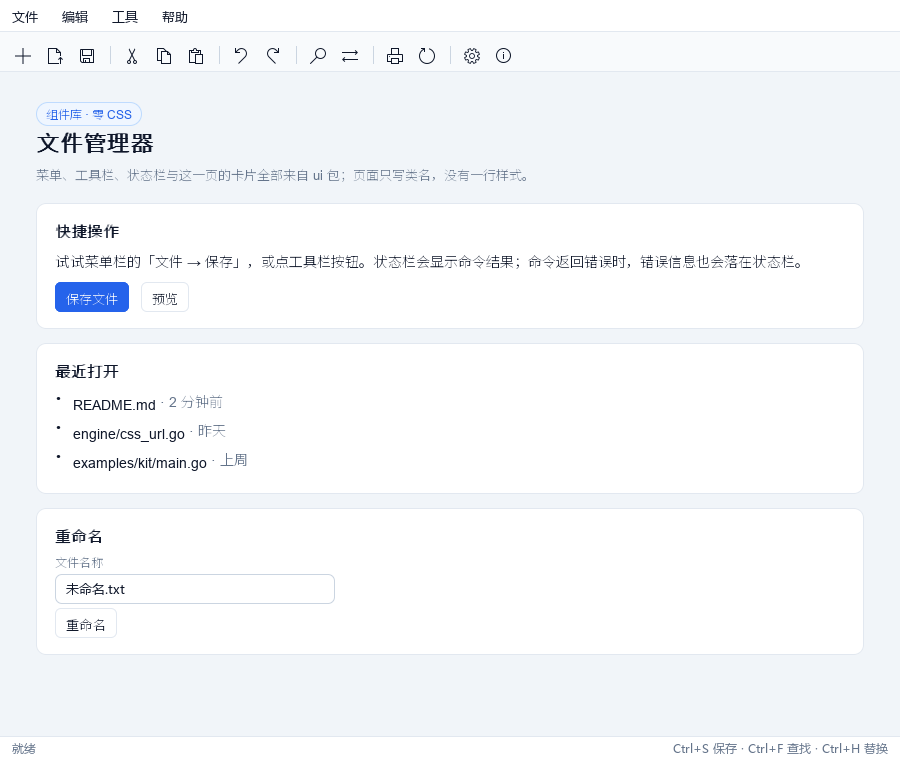
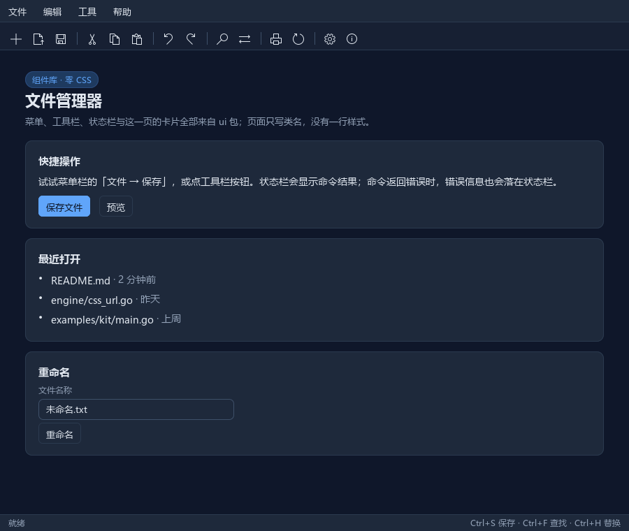
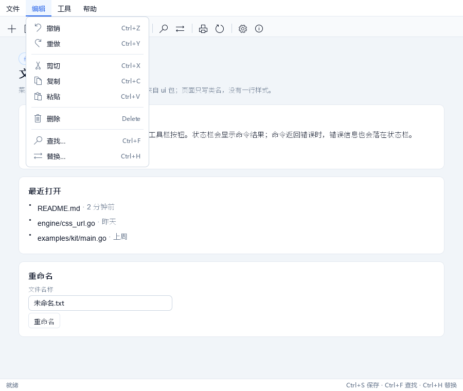
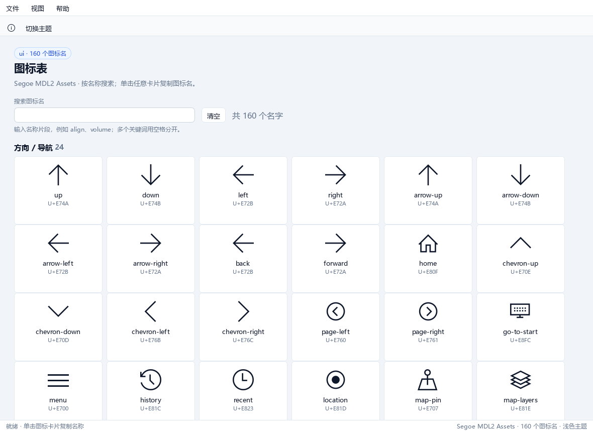
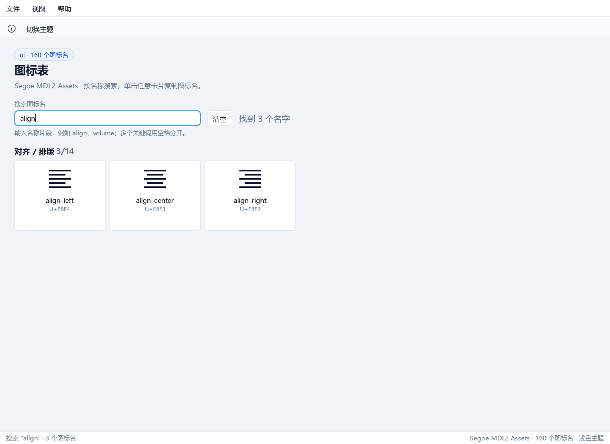

# 组件库 ui

> 本文件是 [README](../README.md) 的分册；接口信息用 `go doc github.com/go-comm/ghromex/<包>` 查。

`ui` 是建在 `browser` 之上的一层「应用工作台」：菜单栏（下拉浮层、快捷键、
禁用态）、工具栏、状态栏、主题，外加一套只写类名的页面组件。应用侧只需
一张命令表（`save`/`about` 是返回 `error` 的函数，`editor.Dirty` 是
`func() bool`）：

```go
spec := ui.Spec{
	Title: "我的应用", Width: 900, Height: 700,
	StatusSegments: []ui.StatusSegment{
		{Key: "file", Text: "就绪", Width: 220},
		{Key: "pos", Text: "行 1，列 1", Width: 140},
	},
	StatusRight: "Ctrl+S 保存",
	Menus: []ui.Menu{{Title: "文件", Items: []ui.Action{
		ui.Item("保存", "Ctrl+S", save).WithIcon("save").When(editor.Dirty),
		ui.Sep(),
		ui.Item("退出", "Alt+Q", ui.Quit),
	}}},
	Tools: []ui.Action{
		ui.Tool("保存", save).WithIcon("save").When(editor.Dirty),
		ui.Sep(),
		ui.Tool("关于", about).WithIcon("info"),
	},
}

app, err := ui.New(spec)
if err != nil {
	return err
}
defer app.Close()
if _, err := app.LoadHTML(page); err != nil {
	return err
}
return app.Run()
```

状态栏左侧可以分段：`StatusSegment.Width` 固定列宽（0 为按内容自适应），
`Align` 控制段内对齐，`Hidden` 可临时隐藏；段与段之间自动生成 1px 分隔线。
高频更新只改文字，不重建 DOM：

```go
sh.SetStatusSegment("file", "README.md *")
sh.SetStatusSegment("pos", "行 12，列 4")
sh.SetStatusSegment("chars", "1,024 个字符")
```

右侧消息独立更新（`SetStatusRight`），非空时按 `Theme.StatusRightWidth`
预留宽度；旧写法 `Spec.Status` / `SetStatus` 仍可用，等价于一个
`Key: "status"` 的段。

内置浅色与深色两套主题，`Spec.Theme` 留空时用浅色；换深色只需：

```go
dark := ui.Dark()
spec.Theme = &dark
```

页面内容只写类名，样式全部来自注入的主题样式表：

```html
<div class="system-ui-page">
	<span class="system-ui-badge">新</span>
	<div class="system-ui-title">文件管理器</div>
	<div class="system-ui-subtitle">一行说明</div>
	<div class="system-ui-card">
		<div class="system-ui-h2">快捷操作</div>
		<div class="system-ui-text">正文</div>
		<span class="system-ui-label">名称</span>
		<input class="system-ui-input" type="text">
		<div class="system-ui-actions">
			<div class="system-ui-btn is-primary">保存</div>
			<div class="system-ui-btn">预览</div>
		</div>
	</div>
</div>
```

控件也可以由 Go 侧构造，省去类名和取值/禁用态的样板；返回的 `*XxxView`
都实现了 `Element()`，可以放进任意页面容器：

```go
name := ui.NewTextInput(doc, "未命名.txt")
field := ui.NewField(doc, "文件名称", name)
field.SetHint("最多 255 个字符")
page.AppendChild(field.Element())

auto := ui.NewCheckbox(doc, "保存时自动备份", true)
auto.OnChange(func(on bool) { /* ... */ })
page.AppendChild(auto.Element())

enc := ui.NewSelect(doc, []ui.SelectOption{
	{Value: "utf-8", Label: "UTF-8"},
	{Value: "gbk", Label: "GBK"},
})
enc.OnChange(func(value string) { /* ... */ })
page.AppendChild(enc.Element())

preview := ui.NewTextView(doc, "只读多行文本；换行会保留。")
page.AppendChild(preview.Element())
```

`ui.NewButton` 是内容区按钮（底层 `<button type="button">`），与工具栏的
`ui.Tool`（构造 `Action`）区分。`TextInput`/`TextArea` 目前没有实时的
`input`/`change` 事件，实时联动请用 `OnKeyDown`，或在命令执行时读取
`Value`。`TextView` 是只读多行视图，`TextAreaView` 才是可编辑输入。

可用组件类：`system-ui-page`/`system-ui-title`/`system-ui-subtitle`/`system-ui-badge`/`system-ui-alert`/`system-ui-card`/
`system-ui-h2`/`system-ui-text`/`system-ui-label`/`system-ui-input`/`system-ui-select`/`system-ui-textarea`/
`system-ui-textview`/`system-ui-check`/`system-ui-field`/`system-ui-field-hint`/`system-ui-field-error`/
`system-ui-btn`/`system-ui-actions`/`system-ui-list`/`system-ui-muted`。

所有组件类都带 `system-ui-` 前缀，并且只在 `Install` 加到 `<html>` 上的
`system-ui` 根作用域下生效；根作用域把组件规则的特异度抬高一档，第三方
`.panel div` 之类的后代选择器压不过。前缀本身不保证唯一，避免重名仍以
根作用域为主。

主题内置六组语义色，按钮、徽标、提示条用 `is-*` 后缀，文字色用 `system-ui-text-*`：

| 语义 | 后缀 | 浅色实底 / On | 深色实底 / On | 用途 |
| --- | --- | --- | --- | --- |
| 强调 Primary | `is-primary` | `#2563EB` / `#FFFFFF` | `#60A5FA` / `#0B1220` | 主按钮、选中、焦点 |
| 默认 Default | `is-default` | `#FFFFFF` / `#0F172A` | `#1E293B` / `#E2E8F0` | 次按钮、取消 |
| 成功 Success | `is-success` | `#15803D` / `#FFFFFF` | `#4ADE80` / `#052E16` | 完成、通过 |
| 警告 Warning | `is-warning` | `#F59E0B` / `#451A03` | `#FBBF24` / `#451A03` | 待处理、风险 |
| 危险 Danger | `is-danger` | `#DC2626` / `#FFFFFF` | `#F87171` / `#2A0505` | 删除、错误 |
| 信息 Info | `is-info` | `#0E7490` / `#FFFFFF` | `#22D3EE` / `#083344` | 说明、辅助 |

```html
<div class="system-ui-actions">
	<div class="system-ui-btn is-success">通过</div>
	<div class="system-ui-btn is-danger">删除</div>
</div>
<span class="system-ui-badge is-warning">待处理</span>
<div class="system-ui-alert is-info">共 12 项，已全部同步。</div>
<span class="system-ui-text-danger">保存失败</span>
```

按钮用实底/`On*`；徽标与提示条用 `*Soft` 淡底、`*Border` 描边和 `*Text`
文字。`Default` 不单独存令牌，复用 `Surface`/`Border`/`Text`/`SurfaceAlt`/
`Press` 这组中性色。对比度由主题负责（Warning 的实底用深色字，其余实底在
浅色主题用白字、深色主题用同色系深字）。







几个设计约定：

- **命令与呈现分离**：`Action` 同时给菜单项和工具栏按钮用，快捷键只写一次；
  `Run` 返回 `error`，错误直接写到状态栏，`ui.Quit` 请求关窗。
- **可用性是拉取的**：`When(f)` 在菜单打开时、`Refresh()` 时求值，不做每帧
  轮询；禁用项点击无效、快捷键仍会被吞掉（不会漏到页面里）。
- **快捷键先于页面**：走 `browser.Window.SetKeyHandler`，输入框聚焦时
  `Ctrl+S` 也先到应用。修饰键按家族匹配（左右 Ctrl 都算），字母不分大小写。
- **换文档自动重装**：工作台是文档的一部分（`position:fixed` + body 首尾占位块），
  `App` 通过 `SetOnDocument` 在每次 `OpenDocument` 后重装；只想要文档层
  （无头导出、嵌进已有窗口）时直接用 `ui.Install(doc, spec)`。
- **主题是令牌**：内置 `ui.Light()` 与 `ui.Dark()`，各生成一整张样式表；改
  `ui.Theme` 的字段即可换色/换圆角（`spec.Theme = &theme`）。深色主题的强调色
  更亮，主按钮文字由 `OnAccent` 保证对比度。语义色每组都有实底、悬停、`On*`、
  淡底、描边和淡底文字；`Default` 复用中性令牌，避免同一颜色存两份。主题测试
  用 WCAG AA 的 4.5:1 校验实底与淡底文字。零值字段统一按浅色补齐，所以微调
  深色要先取 `ui.Dark()` 再改字段，不能只写一两个颜色指望自动变深。只使用引擎
  支持的 CSS 子集；主题保持扁平（不用阴影），没有过渡，横向排列靠 `inline-block`，
  分隔线是 1px 的实体元素。
- **图标是字体字形**：`WithIcon("save")` 从内置表取 Segoe MDL2 Assets 的码位，
  覆盖文件/编辑、方向/导航、对齐/排版、播放/媒体、视图/窗口和通用命令（完整表
  见 `ui/icon.go` 的 `iconGlyphs`），也可以直接传字符。工具栏有图标时只画图标
  （30×30 方形按钮），没图标时退回文字；菜单里只要有一项带图标，整张菜单就
  预留图标列。图标字体是 Windows 10/11 自带的 `segmdl2.ttf`（颜色跟随 `color`，
  悬停/禁用自动变色）；其他平台在 `Theme.IconFont` 里换一个同编码的字体，或者
  不调 `WithIcon` 只用文字。

常用图标名：

| 分类 | 图标名 |
| --- | --- |
| 方向/导航 | `up` `down` `left` `right` `chevron-up` `chevron-down` `chevron-left` `chevron-right` `page-left` `page-right` `back` `forward` `home` `go-to-start` |
| 对齐/排版 | `align-left` `align-center` `align-right` `bulleted-list` `list` `check-list` `bold` `italic` `underline` `font-size` `font-color` `highlight` |
| 播放/媒体 | `play` `pause` `stop` `record` `previous` `next` `rewind` `fast-forward` `shuffle` `repeat` `repeat-one` `volume` `mute` `fullscreen` `back-to-window` |
| 文件/编辑 | `new` `open` `save` `save-as` `copy` `cut` `paste` `undo` `redo` `search` `replace` `print` `delete` `refresh` |
| 视图/窗口 | `zoom-in` `zoom-out` `fit-page` `view` `view-all` `preview` `dock-left` `dock-right` `dock-bottom` `close-pane` `open-pane` `minimize` `maximize` `restore` `window-close` |
| 通用 | `check` `close` `add` `remove` `more` `filter` `settings` `info` `help` `warning` `error` `completed` `favorite` `share` `link` `attach` `send` `folder` `calendar` `sort` `download` `upload` |

别名：`arrow-up`/`arrow-down`/`arrow-left`/`arrow-right`、`open-file`、`trash`、
`reload`、`printer`、`plus`、`minus`。

想看全部图标和实际字形，运行 `go run ./examples/iconsheet`；启动后可用工具栏
「切换主题」或「视图」菜单在浅色/深色之间切换，`-dark` 可直接以深色启动。
图标来自 `ui.Icons()`。顶部搜索框按名称实时过滤（多个关键词用空格分开），
也可以用 `-search align` 启动时预填；单击卡片会把名称复制到剪贴板。




限制：`ui` 不接管原生窗口菜单；菜单只支持鼠标操作（`Esc` 收起，没有方向键/
回车导航）；页面里 `z-index` 高于工作台（1100）的元素会盖住菜单栏；窗口很窄时
靠右的菜单浮层可能超出右边缘（浮层左对齐菜单标签，不做翻转）；内置主题只有
浅色/深色两套，更多配色改 `Theme` 字段。

跑一下示例（`-shot` 真实窗口截图：真实字体看最终观感，`-shot-menu` 连菜单一起拍）：

```
go run ./examples/kit
go run ./examples/kit -dark
go run ./examples/kit -shot kit.png -shot-menu 文件
go run ./examples/kit -dump-icon icon.png   # 把生成的窗口图标写成 PNG（核对形状/透明边）
go run ./examples/kit -no-icon              # 不设窗口图标（用系统默认图标）
go run ./examples/iconsheet
go run ./examples/iconsheet -dark
```
